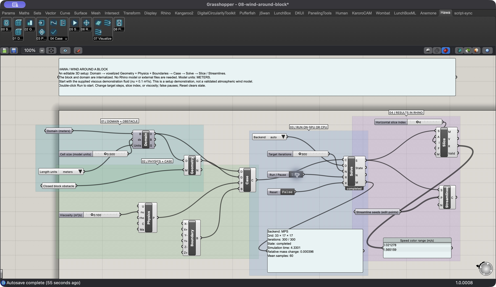
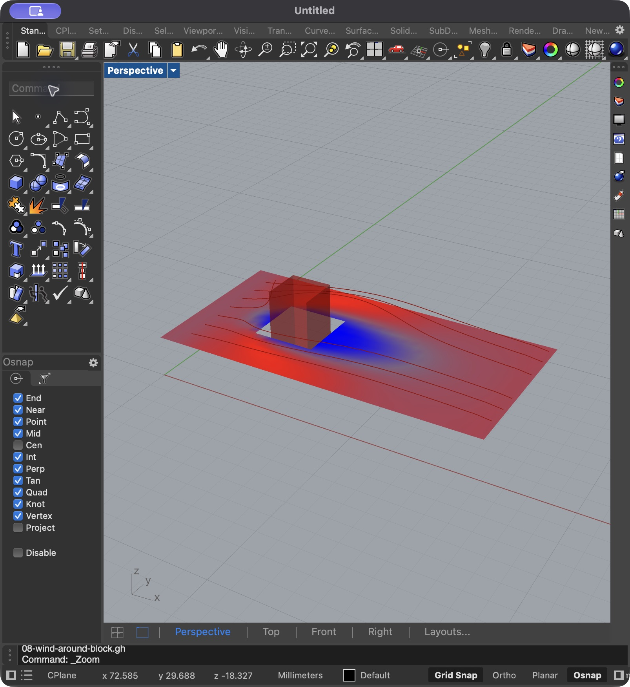

# Hawa

**GPU lattice Boltzmann simulation for Rhino 8 and Grasshopper.**

Hawa runs the numerical engine in Rhino's Python runtime. Define the case in Grasshopper. View the velocity and pressure in Rhino.

[Project page](https://range-et.github.io/hawa-cfd/) · [Download v0.2.0](https://github.com/range-et/hawa-cfd/releases/download/v0.2.0/Hawa-0.2.0-rh8.zip) · [Installation guide](docs/plugin.md) · [Examples](examples/grasshopper)



## Scope

This release is an experimental prototype. It includes:

- **15 Grasshopper components** for domains, geometry, physics, solving, results, and files.
- **8 editable `.gh` definitions** with controls and instructions.
- **Python 3.9 and PyTorch 2.8.0** inside Rhino.
- **Device selection** through `auto`, `cpu`, `mps`, or `cuda:0`.
- **Results** through field slices, point sampling, velocity vectors, snapshot streamlines, and local NPZ files.
- **Lettuce source and tests**, plus Hawa compatibility checks and an unmodified upstream reference environment.

Apple GPU acceleration uses PyTorch MPS. CPU and MPS checks passed on this Mac. NVIDIA hardware and Windows installation checks remain open.

## Install

1. [Download the plugin ZIP](https://github.com/range-et/hawa-cfd/releases/download/v0.2.0/Hawa-0.2.0-rh8.zip).
2. Copy the complete **Hawa** folder into Grasshopper's Libraries directory.
3. Restart Rhino 8.
4. Open `Hawa/examples/01-tgv3d-bgk.gh`.
5. Allow Rhino to install the pinned dependencies. This first setup needs internet access.
6. Select **auto** in Backend.
7. Double-click **Run / Pause**.
8. Keep Grasshopper open while you inspect the Rhino preview.

The package uses Rhino's Python runtime. The numerical solver runs in Rhino's process. If another script loaded an incompatible NumPy version, restart Rhino before you initialize Hawa.

See [the plugin guide](docs/plugin.md) for units, controls, and troubleshooting.

## Videos

The videos use captions and screenshots from the verified Rhino sessions. They have no audio. The edits use the Monad palette and Helvetica titles.

| Video | YouTube |
| --- | --- |
| Hawa overview | [Watch](https://youtu.be/Ji_9iOYXSXg) |
| 3D block flow | [Watch](https://youtu.be/PVBanKHGhC4) |

<!-- HAWA_VIDEO_LINKS -->

[Video source and captions](docs/media/README.md) · [Original captures](docs/captures/README.md)

## Examples

The gallery contains five Taylor–Green cases, a driven cavity, a forced channel, and a physical block case.

Open `08-wind-around-block.gh` to follow the full workflow:

```text
Domain → Geometry + Physics + Boundaries → Case → Solve → Slice / Streamlines
```

The block definition contains its geometry. Its length units are meters. Its demonstration viscosity is `0.1 m²/s`. Atmospheric validation remains open.



### Controls

- Set Run to false to pause.
- Toggle Reset from false to true to clear the state.
- Toggle Run from false to true to start or resume.
- Set Target iterations to the required total count.
- Set Slice index to `-1` to select the center.

Pause the solver before you change its case or backend. Those changes create an idle session.

## Development

The production target is Python 3.9 with PyTorch 2.8.0 and NumPy 2.0.2. A separate Python 3.12 environment runs unmodified upstream Lettuce for reference comparisons.

```sh
uv sync --extra test
.venv/bin/python -m pytest tests -q
.venv/bin/python scripts/audit_backport.py
.venv/bin/python scripts/run_upstream_tests.py
.venv/bin/python scripts/bootstrap_reference.py
.venv/bin/python scripts/run_upstream_tests.py --reference
.venv/bin/python scripts/compare_engines.py
.venv/bin/python scripts/run_examples.py --device cpu
.venv/bin/python scripts/run_examples.py --device mps
.venv/bin/python scripts/build_plugin.py
```

The Grasshopper build needs the installed Rhino SDK. Run `scripts/create_grasshopper_examples.cs` inside Rhino to create the `.gh` files. Run `scripts/verify_grasshopper_examples.cs` to reopen and check those graphs.

The C# helper scripts contain this checkout's paths. Change the paths before you run the scripts on another machine.

### Website and videos

The website and video renderer use the pinned Monad palette in `vendor/monad_system/colors.json`.

```sh
.venv/bin/python scripts/sync_design_tokens.py
.venv/bin/python scripts/build_site.py
.venv/bin/python scripts/make_walkthroughs.py
```

The video renderer needs macOS Helvetica Neue and Menlo, Pillow, ffmpeg, and ffprobe. It writes the MP4 files to ignored `dist/videos-monad/`.

## Verification

| Check | Result |
| --- | --- |
| Hawa tests | 77 passed, 29 skipped |
| Vendored upstream tests | 419 passed, 884 skipped |
| Core CPU comparisons | FP32 and FP64 arrays matched the upstream oracle bitwise |
| Core MPS comparisons | Arrays passed the declared tolerances |
| Original executable examples | All 16 completed bounded CPU and MPS runs |
| Native Grasshopper graphs | All 8 reopened and completed 25 MPS steps with valid slice meshes |
| Visible Rhino runs | Vortex: 200 MPS iterations. Block: 300 MPS iterations |

The clean Rhino session used CPython 3.9.10, PyTorch 2.8.0, and NumPy 2.0.2.

The default example harness limits runs to 50 steps. It permits 250 steps for the intentional failure example. Full-duration convergence checks remain open.

PorousMedium has a known pointwise CPU/MPS difference after the bounded FP32 KBC run. Its geometry masks match. The strict pointwise comparison remains open.

The gallery contains eight `.gh` files. Wrappers for the remaining upstream examples remain open. Production CFD validation, NVIDIA checks, and Windows installation checks also remain open.

See [the verification notes](docs/backport.md) for the check scope and upstream exclusions.

## Attribution

- **Hawa:** MIT license. See [LICENSE](LICENSE).
- **Lettuce:** MIT license. The vendored source retains its original copyright and author notices.
- **Butterfly:** GPL-3.0+ workflow reference. Hawa contains no Butterfly code or assets.
- **Monad System:** MIT license. The website and videos use its pinned colors and styles.

See [the third-party notices](THIRD_PARTY_NOTICES.md) and [the Monad license](vendor/monad_system/LICENSE).
