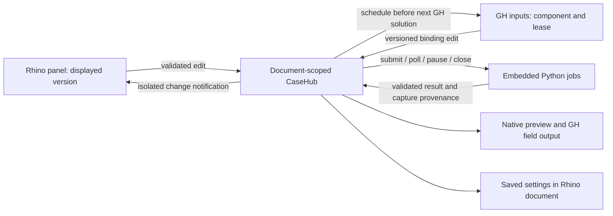

# Hawa 0.5 architecture review and interface benchmark

Reviewed November 8, 2026. Scope: the native block-flow prototype, its shared
case service, and the Linked Case Grasshopper adapter. This is an interface and
software-contract comparison. Competitor executables were not performance-tested
or internally audited. Hawa remains an experimental CFD tool.

## What the prototype taught us

Both interfaces can use one simulation. The difficult part is defining who may
change it, when a change takes effect, and which result a view is showing.
The shared service now owns those rules. Rhino and GH remain adapters.

The public `CaseState` is a read-only live view on the UI thread. JSON accessors
return detached copies; it is not an immutable atomic snapshot of the whole case.
`ResultStamp` is immutable. Consumers that need a stable record should capture
`Describe()` or a field snapshot on the UI thread.

| Data | Identity and lifetime | Rule |
| --- | --- | --- |
| Saved case definition | Schema 1 and persistent case GUID; saved in `.3dm` | Settings only. Reopen stays idle. No worker or binding is restored. |
| Live case | Rhino document runtime serial plus case object | One service-owned case per open document. Copies with the same saved GUID remain isolated. |
| Settings version | Monotonic `Version` | Every settings edit checks the version the writer actually read, including field and target edits. |
| Physics revision | Monotonic `Revision` | Speed, cell size, width or backend edits invalidate the physical run. Display and target edits preserve it. |
| Run generation | Monotonic `Generation` plus session/job IDs | Invalidated before cancel/reset/replacement calls cross the Python bridge. |
| Field result | Case GUID, physics revision, generation, session, field, capture step, physical time | Validate the complete response before publishing. Solver progress and field time are separate. |
| GH binding | Component GUID plus fresh lease GUID | One live owner. An old writer or old unbind cannot change the replacement binding. |
| View cache | Case GUID, `ResultVersion`, Rhino units | Units rescale the preview without changing physical geometry or restarting the run. |
| Failure | Solver/control fault, view error, pending cleanup | A view failure retains the healthy solver and last good field. Cleanup failures retain ownership for retry. |

## Exchange and failure rules implemented

1. Commands execute on Rhino's UI thread. Numerical work uses embedded Python
   background jobs. Adapters do not wait for a run to complete.
2. A panel edit validates the whole patch before applying it. Rejected edits
   refresh controls to the accepted values. Undo records end even on failure.
3. GH accepts one finite value per linked input. Direct sliders are bidirectional;
   computed inputs are panel-read-only. Invalid inputs release the binding.
4. Native-to-GH pulls run in `ScheduleSolution` callbacks before input acquisition.
   `SolveInstance` defers while a pull is pending. It never changes slider values.
   A callback checks document, case identity, owner, lease and callback generation.
   All slider targets are validated before any slider changes.
5. Locked components remember pending pulls. Closing/unloading a GH definition
   invalidates its callbacks and releases its binding. Closing the panel retains
   the case; closing the Rhino case disposes its runtime resources.
6. Observer exceptions are logged per subscriber. They cannot abort another
   observer, leave an undo record open or mark a healthy solver as failed.
7. A field-query error has a bounded automatic retry and an explicit Refresh field
   action. A malformed response cannot partially replace the last good snapshot.
8. Native preview labels retained results as outdated. GH withholds outdated field
   meshes. Linked Case's live Solution output is not a completed fitness result.
9. Close operations are idempotent. Failed cleanup requests stay in a retry queue.
   A close requested during a command drains after the command releases its guard.
10. Restore publishes one coherent idle state. An old undo record cannot recreate
    a closed case or overwrite a replacement case.

The live Rhino test exposed a real host constraint: setting a slider inside
`SolveInstance` caused the GH “expired during a solution” breakpoint. Moving the
write to the pre-solution callback fixed it. Headless service tests alone cannot
verify Grasshopper scheduling behavior.

## Comparison with established tools

| Reference | Documented behavior | Hawa decision and remaining gap |
| --- | --- | --- |
| KaroroCAM | Rhino workflow with toolpath/stock/clearance overlays and preview pause, speed and position controls | Keep solve controls separate from display/playback controls. Add view visibility, legend and playback to the full panel. Current prototype has a domain and field preview; it has no native playback timeline. |
| Kangaroo | Regular solver publishes live iterations; Zombie publishes at its stopping point | Keep live visualization separate from completed evaluation. Use candidate-tagged completion for optimization. Live output alone cannot tell a search loop that fitness is ready. |
| Karamba | GUI and parametric view variants share functionality/defaults; asynchronous acquisition and processing are separate, with explicit Galapagos limitations | Use one parameter schema and validation service for both interfaces. Keep Hawa Search's completion contract. Do not assume adding background threads makes Galapagos asynchronous. |
| Rhino/Eto host guidance | Controls and windows must be associated with the correct document, especially on macOS | Retain explicit document identity in the panel/service. Expand document switching and lifecycle tests before broadening the native UI. |

Sources: [KaroroCAM main menu](https://sites.google.com/view/karorocam/main-menu),
[preview](https://sites.google.com/view/karorocam/preview),
[machine setup](https://sites.google.com/view/karorocam/machine-setup);
[Kangaroo author on live and Zombie outputs](https://discourse.mcneel.com/t/kangaroo-solver-question/162609/2);
[Karamba view components](https://manual.karamba3d.com/3-in-depth-component-reference/3.9-parametric-ui/3.9.1-view-components),
[Karamba async execution](https://manual.karamba3d.com/2-getting-started/2-getting-started-1/2.6-asynchronous-execution-of-karamba3d-components);
[Rhino-specific Eto guidance](https://developer.rhino3d.com/guides/eto/rhino-specific/).

KaroroCAM and KaroroCAD are separate projects. The comparison above concerns
KaroroCAM. The author's [Rhino integration discussion](https://discourse.mcneel.com/t/rhino-8-src14-has-broken-my-rhino-plugins/195628)
describes its GH/ScriptCompiler/YAK and WebView integration. Its internal state,
undo and concurrency contracts are unknown to this review. Historical host issues
are evidence for compatibility testing, not evidence of a current defect.
Kangaroo's publication behavior likewise does not establish its threading model.

## Validation and benchmark interpretation

See [verification-state-v0.5.json](verification-state-v0.5.json) for exact results.
The service tests compile the production CaseHub and CaseState against host and
transport doubles. They inject observer, transport and malformed-result failures.
They complement live Rhino tests; they cannot establish UI or GPU performance.

The measured interaction checks use a 17 × 13 × 9 block-flow grid on macOS
Rhino 8.36 with embedded Python 3.9 and PyTorch 2.8.0. Submission time measures the
command returning. Pause acknowledgement is observed by a timer and includes its
sampling interval. Neither is solver throughput or a competitor ranking.

## Gates before the full 0.5 release

- Extend the persisted definition to geometry references, boundaries and view
  settings through an explicit schema migration. Preserve schema-1 reads.
- Give native geometry references a clear policy for deleted, replaced and
  transformed Rhino objects. Never silently use stale geometry.
- Unify job ownership across the older GH-only components and the shared service.
  The new cleanup queue protects this native path; older components still have
  their own lifecycle code and need a separate migration and failure audit.
- Add bounded preview payloads and profile geometry preparation, JSON transfer,
  mesh conversion and redraw on larger cases. Background numerical work alone
  does not guarantee responsiveness. First runtime initialization is synchronous.
- Test Windows docking, multi-document UI switching, repeated save/reopen and
  long-running edit/pause/cancel cycles. Run CUDA checks on CUDA hardware and test
  dependency installation in a clean Rhino environment.
- Keep a completed evaluation protocol for optimization: candidate ID, accepted
  case revision, completion status, objective and error. The native live preview
  is not a substitute for this protocol.
- Add named display controls, fixed legend ranges and a playback timeline after
  these contracts remain stable. Keep numerical-method selection separate from
  CPU/MPS/CUDA device selection in any future solver work.

Known numerical limits, including unresolved PorousMedium CPU/MPS parity, remain
unchanged. This work improves software state and interaction reliability; it does
not establish engineering accuracy or convergence.
