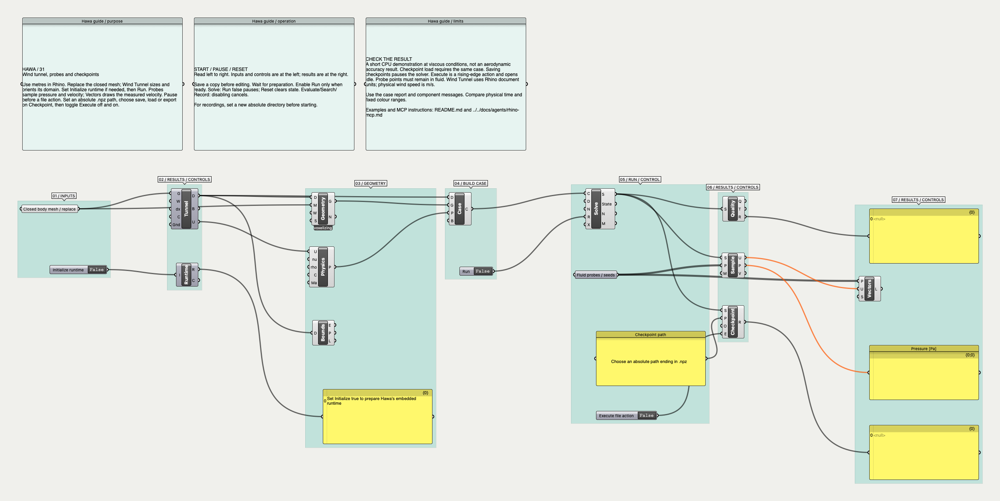
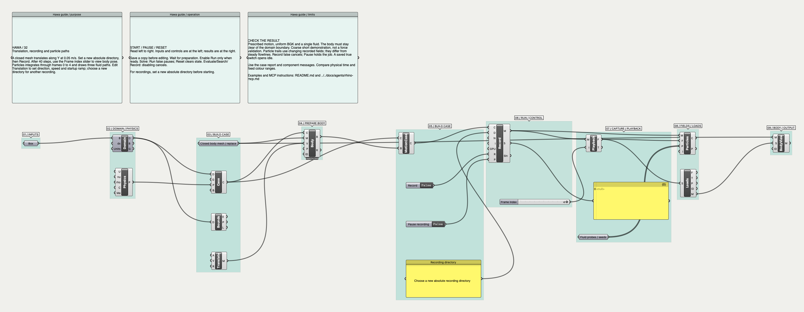

# G6 compatibility matrix and example library

November 9, 2026. Reviewer: Codex, separate self-review passes for G0–G6.
This is a development gate. It is exhaustive over its versioned finite products;
it does not enumerate arbitrary Grasshopper graphs, continuous geometries,
parameter values or all concurrent event sequences.

## Current transfer and shared-view increment

The development run `results/atmosphere-nesting/matrix-trim-final` declares
**102,459 rows: 100,010 passed, zero failed, 2,449 CUDA rows blocked**. It adds
1,728 v2 nesting rows and 1,440 multi-domain view rows. The view product covers
single/nested/disjoint/rotated layouts, masks, time agreement, memory/reload, nine
scalars and five consumers. The test suite has **600 passed, 32 skipped** (CUDA),
with four upstream MRT warnings; 33 state contracts pass. Full test-ID and source
hash checks pass. See [the transfer review](neutral-transfer-review.md).

The current archive inventory covers **54 public nodes, 31 definitions and 191
observed port combinations**. An additional round-trip checks the original port
GUIDs/wires and migration to list inputs. The table at the end uses this inventory.
The earlier evidence below remains historical. Numerical atmospheric qualification
still fails; these discrete compatibility rows cannot certify turbulence statistics.

## Earlier compatibility baseline

**99,291 declared rows: 97,418 passed, 0 failed, 1,873 blocked on unavailable CUDA.**
CPU and MPS were exercised with Python 3.9 and PyTorch 2.8.0 on macOS. A passing
rejection checks an unsupported contract; it is not a simulated flow. The complete
run took 220 seconds. [Machine report](verification-compatibility.json).

| Product | Rows | Accepted / executed on available devices | Expected rejections | Blocked |
| --- | ---: | ---: | ---: | ---: |
| Six faces × six condition types, NEE and shifted external | 93,312 | 1,392 preflight acceptances | 91,920 | 0 |
| Four solver modes × six collisions × five geometry fixtures × uniform/mapped × three devices | 720 | 150 four-step runs | 330 | 240 |
| Same base product through the actual coupled refinement service, plus clear interior-solid fixture | 723 | 4 two-coarse/four-fine-step runs | 478 | 241 |
| Every accepted six-face topology × three devices | 4,176 | 2,784 four-step runs | 0 | 1,392 |
| Two dimensions × solid/fluid × memory/reload × nine scalars × five field consumers | 360 | 324 operations | 36 (2D isosurfaces) | 0 |

The six face types are wall, slip, periodic, velocity, open and pressure. Modes
are legacy, NEE, neutral precursor and neutral external. Collisions include the
explicit legacy/corrected SGS versions. Geometry fixtures are empty, interior,
curved links, cropped and translating. The base refinement interior fixture
intentionally touches its interpolation stencil and must reject; the additional
clear interior fixture must run. CPU/MPS are FP32 here. CPU64 analytical checks
remain in the numerical gates.

Runtime assertions require the requested iteration, finite fields and positive
density. Field assertions compare manufactured values, preserve masking, check
reloads, and require valid output geometry where expected. These short checks do
not measure convergence, turbulent statistics, wall accuracy or open-boundary
reflection. Those claims have separate numerical tests and
[neutral-coupling evidence](neutral-coupling-review.md).

**575 Python tests passed; 31 skipped; 4 existing MRT warnings.** All 33 .NET state
contracts passed. All 31 skips are explicitly due to unavailable CUDA hardware. The gate compares the JUnit test IDs with a fresh
collection, so a filtered/partial suite cannot satisfy the full-suite requirement.

## Example coverage

The [archive inventory](coverage-example-graphs.json) records all public component
GUIDs, ports, guide panels, source hashes and actual wires. All **52 public nodes**
appear across **30 annotated GH definitions**, with **178 distinct observed
source-port/destination-port combinations**. Legacy user-modified example 09 is
excluded and preserved. Native examples 21–22 are included. Native-only 3dm
examples are separate from this GH archive count.

Every included GH archive loads without missing/corrupt messages and all run
toggles are off. This is a fresh archive audit, not a fresh simulation of all older
workflows. Their numerical and lifecycle evidence remains explicitly dated in
[VERIFICATION.md](../examples/grasshopper/VERIFICATION.md).

Two new human-readable workflows fill the previous gaps:

- [31: Tunnel, probes and checkpoint](../examples/grasshopper/31-tunnel-probes-checkpoint.gh):
  Wind Tunnel, Runtime, Sample, Vectors and Checkpoint. Live Rhino CPU60 produces
  three valid velocity/pressure probes and vectors. Save, load and export complete;
  the exported array is finite and has shape 3×21×16×16. Use metres in Rhino.
- [32: Translation and particles](../examples/grasshopper/32-translation-particle-recording.gh):
  Translation, Moving Body, Record, Playback, Particles and Body Preview. Live
  CPU40 writes five frames, then produces three particle paths and a matching body
  pose. A new absolute recording directory is required.

Both were tested through embedded Python in Rhino 8, without waiting on its UI
thread. Owned documents were disposed; pending cleanup reached zero. Their source
files remain idle. Canvas captures were inspected:




The examples form a covering library. Generators expand machine variations from
small explicit fixtures; thousands of duplicate GH files would make the human
library harder to maintain. The node-to-example table below is generated from the
archive inventory. New nodes without an example fail G6.

## Reproduce the gate

From a developer checkout, first run `scripts/audit_example_graphs.cs` through Rhino
MCP after component/archive changes. It reads archives without starting solvers or
writing source definitions. Then use a new evidence directory:

```sh
.venv/bin/python scripts/run_compatibility_matrix.py --output results/g6/run-NEW
.venv/bin/python -m pytest tests -q --junitxml=results/g6/pytest-NEW.xml
dotnet run --project tests/dotnet/StateContracts > results/g6/state-NEW.log
.venv/bin/python scripts/check_compatibility_evidence.py \
  --matrix results/g6/run-NEW \
  --junit results/g6/pytest-NEW.xml \
  --state-log results/g6/state-NEW.log
```

Add `--release` to the runner and evidence checker to fail on unavailable required
hardware/skipped tests. Each available device must run; there is no device fallback.
The run writes `running` before execution, rows incrementally and `complete` only
at the end. It checks exact IDs/counts, expected acceptance, duplicates, raw-row
hash, unchanged Hawa/Lettuce/source and dependency-lock hashes, runtime versions and current example hashes. A crash, missing row,
empty selection or stale source cannot reuse an old pass. Regression tests exercise
missing/duplicate/unknown/false-pass evidence and public enum/catalog drift.

For the live additions, execute one action per MCP call using
`scripts/verify_coverage_examples.cs`: open → run → report; for 31 also
save → execute → report, load → execute → report, export → execute → report;
then close. Never run the whole sequence in a UI-thread polling loop. Use copies
under `results`, preserve source hashes and verify cleanup. The older host/state
harnesses remain required when their adapters change.

## Complementary contract and regression families

| Surface | Required executable evidence | Human fixtures |
| --- | --- | --- |
| Background solve, pause/resume/reset/close, atomic checkpoints | `test_plugin_service.py`, `test_jobs.py`, StateContracts | 01–08, 31; native 21–22 |
| Optimization and candidate identity | `test_optimization.py`, `test_jobs.py`, `test_motion.py` | 10, 20 |
| Imported boundary series, units, masks, provenance, exhaustion | `test_boundary_data.py`, `test_general_boundaries.py` | 24–27 |
| Rough walls, shifted storage, exterior/body ownership, reversal | `test_neutral.py`, `test_neutral_external.py`, numerical scripts | 28–30 |
| Translation, rotation, linear/angular oscillation, loads and restart | `test_motion.py` | 17–20, 32 |
| Immutable fields, contour/iso/vector/flow displays | field product, `test_fields.py`, StateContracts | 11, 15–16, 23, 30–32 |
| Recording/playback/pathlines and corrupt/missing data | `test_recording.py`, `test_motion.py` | 13, 16–19, 32 |
| Local airfoil coordinates/polars and wing analysis | `test_airfoils.py` | 12, 18 |
| Coupled refinement and solid/interface clearance | refinement product, `test_refinement.py` | 14 |
| Backend selection and backport behavior | `test_engine.py`, `test_port_features.py`, separate upstream suites | 01–08 |
| Native/GH state, ownership, delayed callbacks and cleanup | StateContracts plus applicable live MCP harnesses | native 21–23 |

These named families complement the finite products. They do not claim exhaustive
continuous parameters, arbitrary body counts, every motion trajectory or all
possible asynchronous interleavings. New capabilities must extend the explicit
inventory, negative cases, example mapping and applicable numerical references.

## Findings and gate disposition

The field product reproduced **HAWA-020**: two-coordinate 2D streamline seeds were
combined with a padded three-coordinate velocity. The immutable and legacy paths
now preserve the seed coordinate dimension. All 360 field rows and separate
legacy two-/three-coordinate seed regressions pass. After a normal saved Rhino restart, the installed embedded runtime also returns five legacy path points and four immutable-frame path points for a two-coordinate seed. No tolerance was relaxed.

The broader archive audit exposed **HAWA-018**, fixed in the neutral component's
append-only input migration. Existing parameter IDs and wires survive. Full details
are in the neutral-coupling review. Missing-node fixtures are now 31–32.

| Gate | Decision for this change | Evidence / remaining scope |
| --- | --- | --- |
| G0 research | PASS, bounded | No new numerical method or dependency. Existing boundary/model references retained. Finite-product claim declared explicitly. |
| G1 architecture | PASS, bounded | Independent contract oracle; immutable IDs/provenance; evidence fails closed. No new public recipe nodes. |
| G2 software | PASS locally | 575 Python tests, 33 state contracts; 2D repair; exact inventory and stale/partial evidence checks. |
| G3 numerical | PASS for the 2D regression and finite-run contracts | Atmospheric verification is separate; engineering accuracy remains unqualified. |
| G4 examples | PASS for archive coverage and new live workflows | 30 archives; 52 nodes; two new live examples; scoped older evidence retained. |
| G5 distribution | Local development bundle only | GPL notices/source retained; public release, Windows/CUDA and clean-machine installation are not claimed. |
| G6 compatibility | PASS on available CPU/MPS paths; CUDA BLOCKED | 97,418 expected results; zero failures; 1,873 unavailable-device rows. |

The local development package is `dist/Hawa-g6-dev.zip`. Both plugin builds report
zero warnings/errors. ZIP integrity, production/source Python equality, issue and
feature records, example inclusion and legacy-09 exclusion were checked. It is
installed locally; no commit, push or public release was made.

Known PorousMedium CPU/MPS parity, atmospheric qualification, boundary-series v2
and broader refinement remain in [issues.md](../issues.md). G6 does not waive them.

## Public node-to-example map

| Public node | Annotated GH examples |
| --- | --- |
| Hawa Airfoil | 12, 18 |
| Hawa Body Loads | 17, 18, 19, 20, 32 |
| Hawa Body Preview | 17, 18, 19, 20, 32 |
| Hawa Boundaries | 08, 10, 11, 14, 16, 24 |
| Hawa Boundary Capture | 24, 33 |
| Hawa Boundary Data | 24, 33 |
| Hawa Boundary Patch | 25, 26, 27, 30, 33 |
| Hawa Boundary Set | 25, 26, 27 |
| Hawa Case | 08, 10, 11, 14, 15, 16, 17, 18, 19, 20, 24, 25, 26, 27, 28, 29, 30, 31, 32, 33 |
| Hawa Check Case | 17, 18, 19, 20 |
| Hawa Checkpoint | 31 |
| Hawa Color Map | 11, 14, 15, 16, 17, 18, 19, 20, 24, 25, 26, 27, 28, 29, 30, 33 |
| Hawa Domain | 08, 10, 11, 14, 15, 16, 17, 18, 19, 20, 24, 25, 26, 27, 28, 29, 30, 32, 33 |
| Hawa Domain Preview | 10, 11, 14, 15, 16, 17, 18, 19, 20, 24, 25, 26, 27, 28, 29, 30, 31, 32, 33 |
| Hawa Evaluate | 10 |
| Hawa Example | 01, 02, 03, 04, 05, 06, 07, 13 |
| Hawa Field Snapshot | 11, 14, 17, 18, 19, 20, 24, 25, 26, 27, 28, 29, 30 |
| Hawa Flow Display | 11, 14, 16 |
| Hawa Flow Statistics | 33 |
| Hawa Geometry | 08, 10, 11, 14, 15, 16, 24, 27, 30, 31, 33 |
| Hawa Geometry Check | 14 |
| Hawa Grid Preview | 14 |
| Hawa Isosurface | 11, 13, 14 |
| Hawa Legend | 11, 14, 24, 25, 26, 27, 28, 29, 30, 33 |
| Hawa Linked Case | 21, 22 |
| Hawa Motion Case | 17, 18, 19, 20, 32 |
| Hawa Motion Evaluate | 20 |
| Hawa Moving Body | 17, 18, 19, 20, 32 |
| Hawa Neutral Flow | 28, 29, 30, 33 |
| Hawa Oscillation | 17, 18, 20 |
| Hawa Particles | 32 |
| Hawa Physics | 08, 10, 11, 14, 15, 16, 17, 18, 19, 20, 24, 25, 26, 27, 28, 29, 30, 31, 32, 33 |
| Hawa Plane Field | 11, 14, 15, 16, 17, 18, 19, 20, 24, 25, 26, 27, 28, 29, 30, 33 |
| Hawa Playback | 13, 16, 17, 18, 19, 20, 32, 33 |
| Hawa Polar Data | 12 |
| Hawa Record | 13, 16, 17, 18, 19, 20, 24, 32, 33 |
| Hawa Refined Solve | 15 |
| Hawa Refinement Patch | 15 |
| Hawa Result Quality | 24, 25, 26, 27, 28, 29, 30, 31, 33 |
| Hawa Rotation | 19 |
| Hawa Runtime | 31 |
| Hawa Sample | 31 |
| Hawa Search | 10, 20 |
| Hawa Seed Points | 11, 14, 16 |
| Hawa Slice | 01, 02, 03, 04, 05, 06, 07, 08, 10, 14, 24 |
| Hawa Solve | 01, 02, 03, 04, 05, 06, 07, 08, 11, 14, 17, 18, 19, 24, 25, 26, 27, 28, 29, 30, 31 |
| Hawa Streamlines | 08, 10 |
| Hawa Surface Field | 14 |
| Hawa Translation | 32 |
| Hawa Vectors | 31 |
| Hawa Wall Roughness | 33 |
| Hawa Wind Tunnel | 31 |
| Hawa Wing | 12, 18 |
| Hawa Wing Analysis | 12 |
