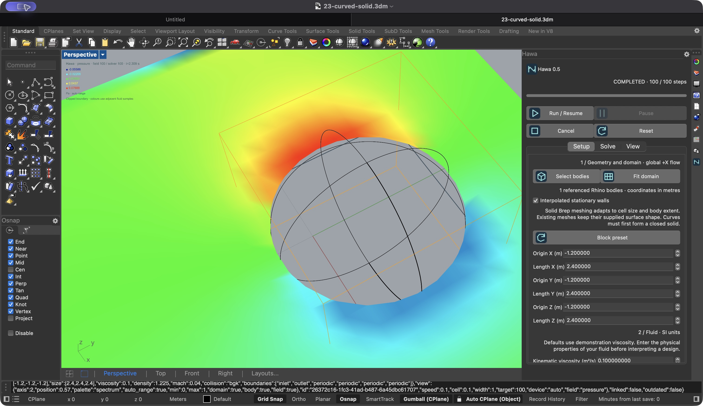

# Curved solid boundaries

This follow-up starts after the expanded 0.5 closeout and core-node audit. It
addresses closed curved solids. A curve alone does not define a 3D solid: use
ordinary Rhino/GH extrusion, lofting and capping to make a valid closed Brep or
mesh. No automatic thickness or fluid region is inferred from an open curve.

Native selected Breps use surface tolerance min(0.002h, 0.01h²/L), where h is
cell size and L is the body bounding-box diagonal. Maximum edge length is 0.5h;
minimum edge length and minimum tolerance are 0.01 times the surface tolerance.
These are mesher controls, not a universal error guarantee. Coordinates are
converted consistently from model units. Existing meshes retain the supplied
surface; use the original Brep to recover curved shape lost in a coarse mesh.

Enable **Interpolated stationary walls** in native Setup and Apply setup, or
connect True to **W** on Hawa Geometry in Grasshopper. Connect the original
closed Brep to the optional **S** input; **M** accepts existing closed meshes. Both paths now share
D3Q19 link/surface intersection code. The existing stationary Bouzidi treatment
uses these fractional distances. Old native settings keep voxel walls by default.
Keep bodies two cells from the domain faces and resolve narrow gaps. Moving
surfaces and local refinement retain their existing separate restrictions.

Rhino's mesh intersection accelerator replaces a triangle scan for every wall
link. Missing/nonpositive intersections and unresolved narrow gaps fail visibly.
Meshing and link preparation remain background work; native mesher calls cannot
be interrupted internally, but cancellation prevents publication afterwards.

## Review criteria fixed before measurement

- Sphere tessellation radial error sampled at face centres and edge midpoints
  must stay below 0.03 cell at each tested resolution; report samples, not a
  formal Hausdorff bound. Halving cell size must reduce absolute maximum error.
- Fractional intersections for an offset analytic sphere must have physical
  maximum error below 0.03 cell. Directions and flat indices must reconstruct
  fluid-to-solid links and agree with the D3Q19 convention.
- Coarse input with no represented solid sites must fail, not silently disappear.
- Fractional-wall equilibrium and CPU/MPS regression tests must keep existing
  tolerances. Fractions on both sides of 0.5 must be exercised.
- Native selected-Brep CPU and MPS runs, settings persistence and cancellation
  must pass through the public shared-case service in Rhino.
- Reopen a GH curved-wall example; validate actual wall links and finite output.

Implementation regression is distinct from engineering accuracy. No change to
collision equations or the existing Python wall formulation is intended. The
uniform lattice still needs grid/domain/time studies for any design result.

## References

[RhinoCommon MeshingParameters](https://developer.rhino3d.com/api/rhinocommon/type/rhino.geometry.meshingparameters/)
defines surface tolerance and edge controls. Reviewed November 8, 2026 against
the installed Rhino SDK. No source was imported.

[Nash et al., PRE 89, 023303 (2014), author manuscript](https://arxiv.org/abs/1211.0205)
compares curved-wall methods in specific pipe-flow benchmarks. It supports using
fractional wall positions; its convergence results are not evidence that Hawa
has achieved the same accuracy. The existing implementation derives from the
Bouzidi/Firdaouss/Lallemand boundary formulation already documented in this repo.

## Field-display correction

The first native preview still had a stepped hole because it discarded every
quad with any solid corner. This was a visualization limitation, separate from
wall interpolation in the solver. Native slices, Linked Case meshes and Hawa
Slice now cut mixed cells at the stored cardinal wall-link intersections.
The resulting outline is piecewise linear at the lattice resolution.

The new boundary vertices are display reconstruction: stationary wall speed is
zero; pressure/density colours use the adjacent fluid sample. Native legends and
GH tooltips state this. Sample/probe values and validity flags are unchanged.
Missing wall data keeps conservative masking; no boundary is invented. Diagonal
fluid corners remain separate, and exact endpoint crossings are deduplicated.

Arbitrary Plane Field sampling, isosurfaces and Grid Preview retain their strict
masking/discrete-grid semantics. Example 14 now displays clipped pressure with
Hawa Slice; its previous Plane Field is hidden for comparison. This is not a new
body-fitted volume mesh or a claim that a coarse flow field is resolved.

## Measured results and review

The initial 0.02h surface setting failed the fixed 0.03h link-position target near
tangency. The final cell/body-scaled setting passed at h=0.2, 0.1 and 0.05 m.
Maximum link-position errors were 0.001691, 0.000648 and 0.000668 m respectively.
Sampled radial surface error decreased at each refinement; maximum link error
was not monotonic. No monotonic flow-convergence claim is made.

Rhino's accelerated line query missed five seam crossings in the native test.
The fallback triangle test resolves those only when the endpoint is inside the
mesh. It avoids a full triangle scan for every ordinary wall link.

CPU/MPS populations after 40 steps on three sphere grids differed by at most
1.20e-7. Native CPU/MPS, geometry changes, cancellation and reopen checks passed.
The clipped-display check exercised all three slice axes for speed and pressure,
without changing solver session or sampled data. Full evidence and exclusions
are in [verification-boundaries-v0.5.json](verification-boundaries-v0.5.json).

Reviewer: Codex, separate research, architecture, development, numerical and UI
passes. No independent specialist approval. Windows/CUDA and clean-machine
installation remain unverified; the historical PorousMedium CPU/MPS issue remains.

