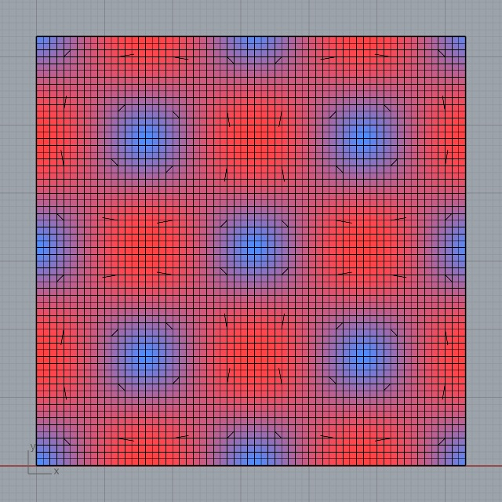

# Embedded runtime feasibility

Historical report for the independent smoke solver before the Lettuce backport.
See [the current engine report](backport.md) for the Python 3.9 compatibility fork.

Measured on November 7, 2026, on the available Apple Silicon Mac. These are smoke
test results, not a performance certification or a full CFD validation.

## Result

The same Hawa numerical core executed on MPS in Rhino's own process and in
standalone Python. CPU, explicit MPS, and auto selection passed in both runtimes.
Auto selected MPS and recorded that CUDA was unavailable. MPS CPU fallback was
unset during verification.

| Property | Rhino | Headless |
| --- | --- | --- |
| Application | Rhino 8.36.26296.17002 | Standalone Python |
| Python | CPython 3.9.10 | CPython 3.12.16 |
| Architecture | arm64 | arm64 |
| PyTorch | 2.8.0 | 2.8.0 |
| NumPy | 1.26.4 | 1.26.4 |
| Devices exercised | CPU, MPS, auto → MPS | CPU, MPS, auto → MPS |

The Rhino report records PID `7492`, matching the Rhino router's process ID, and
executable `/Applications/Rhino 8.app/Contents/MacOS/Rhinoceros`. PyTorch loaded from
the repository's `.runtime/rhino-py39/` target. No solver subprocess was launched.

## Numerical evidence

Case: 64 × 64 periodic D2Q9 Taylor–Green vortex; 200 steps (including a separate
75 + 125 chunked run), BGK relaxation time 0.8, initial velocity amplitude 0.04,
FP32 populations.

| Check | Measured result |
| --- | --- |
| Finite populations | Passed |
| Positive density | Passed |
| Relative mass drift | 1.90735e-6 (0.0001907%) |
| Relative velocity L2 error vs analytic decay, MPS | 0.00140515 (0.1405%) |
| Mean kinetic energy, MPS | 0.0001847073 |
| Analytic mean kinetic energy | 0.0001850085 |
| Maximum Mach number after stepping | 0.04707 |
| Maximum population difference, CPU vs MPS | 2.68221e-7 |

Headless and Rhino MPS runs produced the same numerical diagnostics. The automated
test suite reported **9 passed, 1 skipped**. The skipped test requires a real CUDA
device; CUDA execution on Windows/NVIDIA is still unverified. Tests also cover
analytic decay, mass conservation, exact chunk equivalence, device selection and
invalid configuration rejection.

The initial headless 64² run took roughly 0.15 s on CPU and 0.23 s on MPS for 200
steps. Subsequent timings varied, particularly in Rhino. At this small workload,
CPU was faster; the experiment establishes MPS functionality, not GPU speedup.
Representative 3D grids and profiling are required before choosing optimized
kernels or making performance claims.

The preview uses a colored mesh and sparse velocity segments. Existing Rhino
geometry is not a simulated obstacle: this case has only periodic boundaries.

Raw reports are regenerated under ignored `results/` directories by
`scripts/verify_runtime.py`, `scripts/rhino_vortex.py`, and the CLI.

## Strategy after this experiment

The later decision was to use Python 3.9 for both headless development and embedded
execution, reserving Python 3.12 for an unmodified upstream reference environment.
Keep Rhino references in adapters.

The next numerical milestone is D3Q19 with verified walls, inlets/outlets, and a
simple obstacle case. Then measure representative GPU throughput, memory, and
snapshot costs before implementing Grasshopper scheduling or deciding whether
an embedded runtime remains preferable to a managed local worker.

Unresolved integration questions include long-running UI responsiveness,
cancellation, coexistence with other plugins' native libraries, packaging, and
cross-platform GPU hardware testing. No long-duration stability claim is made.

## Reference context

- [Butterfly workflow](https://www.ladybug.tools/butterfly.html)
- [Lettuce source](https://github.com/lettucecfd/lettuce)
- [Rhino Python runtime](https://developer.rhino3d.com/guides/rhinopython/what-is-rhinopython/)
- [PyTorch 2.8 wheels](https://pypi.org/project/torch/2.8.0/)
