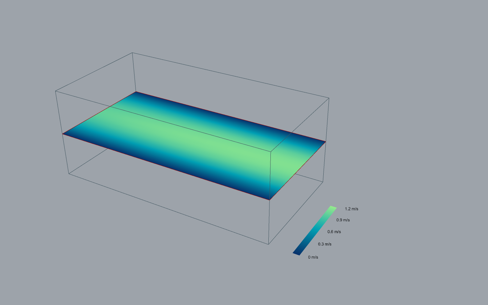
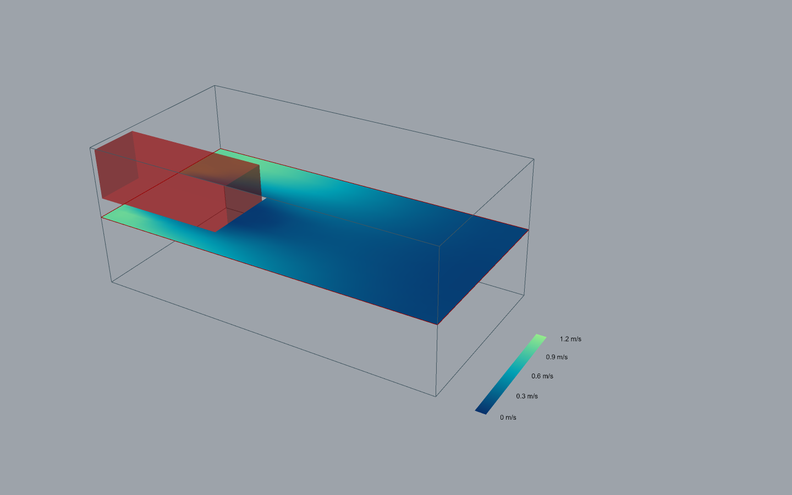

# Shared boundary foundation and LBM implementation

Development build, November 9, 2026. Original Hawa code remains GPL-3.0-only.
No new dependency or third-party source was copied.

## Supported workflow

Create a normal physical Case. Define six **Boundary Patch** objects, one for each
`x-`, `x+`, `y-`, `y+`, `z-`, `z+` face. Connect them as a list to **Boundary Set**.
Connect its validated case to Solve or Record. Boundary Set compiles in a worker;
Check Case now also uses the query worker. Changing inputs invalidates the old
query/result through existing component ownership. No GH polling loop blocks the UI.

The same serializable physical contract is available to headless Python and the
embedded runtime. Native setup controls have not gained an independent patch editor.
The new schema can be retained by a solver adapter; LBM preparation is separate.
SPH and finite-volume numerical adapters are not implemented by this change.

```json
{
  "boundary_method": "hawa-nee-v1",
  "boundary_set": {
    "schema": 1,
    "patches": [
      {"id": "entry", "face": "x-", "condition": {
        "type": "velocity", "velocity": [1, 0, 0],
        "profile": "parabolic", "profile_axis": 1
      }}
    ]
  }
}
```

The snippet shows one patch; a runnable case must include all six. IDs are unique.
Velocity is in m/s in the case's domain axes. Pressure is gauge Pa relative to
reference density. Basis/origin and unit conversion remain in the physical case.
Initial velocity is an explicit three-component m/s value, defaulting to rest in
the GH Boundary Set. It is not the boundary velocity or the reference scaling speed.

| Condition | Meaning in this LBM version |
| --- | --- |
| velocity | Prescribed vector, extrapolated density; uniform, parabolic peak profile, or attached X- v1 file |
| pressure | Prescribed gauge pressure/density, extrapolated velocity |
| open | Outgoing interior normal velocity selects pressure; incoming selects exterior velocity and extrapolated density |
| wall | Resolved no-slip domain wall; optional tangential wall velocity |
| slip | Zero normal velocity and reflection-even non-equilibrium populations; all incident slip planes apply at edges |
| periodic | Opposite faces must both be periodic |

Open exterior velocity must point inward or be tangential/zero. It must match
walls and slip constraints at shared edges. A uniform nonzero exterior velocity
cannot meet a stationary wall at the entire edge: use a quiescent exterior or a
supported different layout. Time-dependent open exterior profiles are future work.
The sign switch is approximate; there is no nonreflection claim.

## Numerical implementation and compatibility

`boundary_contracts.py` validates physical patch data without importing Torch or
exposing lattice indices. `boundaries.py` is the D3Q19 adapter. It compiles disjoint
full-node ownership and donor indices. Full-node non-equilibrium extrapolation is

`f_boundary = equilibrium(rho_boundary, u_boundary) + f_donor - equilibrium(rho_donor, u_donor)`.

All donors are read from one post-stream snapshot. FP32 residual mass and momentum
in the non-equilibrium part are projected out; reconstructed moments are corrected
for equilibrium rounding. Slip planes additionally remove odd reflected stress.
This is full-node reconstruction, not a claim that an incoming-link-only formula
has the same moments. Solid sites are excluded. Domain walls own intersecting nodes,
and compatibility is checked before ownership is assigned. Adjacent flow faces are
rejected; only one opposite pair of velocity/pressure/open faces is qualified here.

A single step coordinator orders collision, capture of post-collision wall data,
streaming, curved-wall corrections and face reconstruction. The mapped inlet can
no longer disappear when curved-wall handling is installed. Overlapping wall/NEE
writers or wall sites used as NEE donors reject rather than overwrite each other.
Legacy mapped/curved-wall inlet overlap also rejects. Existing archived cases keep
their original method; changing to NEE requires an explicit Boundary Set.

Closed source meshes may cross a face in the GH Geometry workflow. Keep the source
closed; do not crop/cap it first. Occupancy is classified in the computation window.
Fluid face sites require valid interior fluid donors. Unsupported curved cuts and
solid donors reject. Native selected-geometry clearance rules remain unchanged.
There is no new adaptive subdivision or unstructured mesh import in this build.

### Smagorinsky audit

The bundled upstream model uses `Cs² (S:S)` rather than `Cs² sqrt(2 S:S)` in its
eddy-viscosity update. The independent physics reviewer confirmed this discrepancy.
Its historical name `smagorinsky` and upstream tests remain unchanged for archive
compatibility. The new explicit **`smagorinsky-v1`** uses full strain (not a
silently substituted deviatoric convention), an unforced BGK operator, Cs=0.17,
and the positive analytic solution:

`A = sqrt(2 Pi_neq:Pi_neq)/(2 rho cs²)`

`tau_eff = (tau_0 + sqrt(tau_0² + 12 Cs² A))/2`.

Manufactured stress tests check weak-strain scaling, sign invariance, zero strain,
Cs=0 equivalence to BGK and the analytic relation. CPU/MPS comparisons cover the
new model. This correction does not qualify atmospheric LES. The molecular
viscosity/FP32 relaxation guard remains in force. No roughness/wall stress closure
or turbulent inflow synthesis has been added.

## Mapping and diagnostics

BoundarySeries v1 remains child-grid-bound X- data. Its reader retains the legacy
positive-normal rule. NEE attachment selects the X- mapped profile and permits zero velocity at
compatible wall edges. Negative velocity on owned fluid inflow nodes remains
rejected; values on solid/wall-owned nodes are not applied as inflow. Wall-edge
compatibility allows a 5e-6 times reference-speed rounding tolerance. File hash, grid, Mach and time
coverage checks remain active. This does **not** implement the planned world-space,
multi-patch BoundarySeries v2 or geometry-mask reconciliation.

Quality includes method identifiers, oriented incoming-node counts, and per-step
fluid mass storage/collision/streaming/reconstruction changes. Streaming includes
solid reservoirs and periodic roll values later reconstructed at external faces.
These quantities expose reconstruction mass changes; they are **not** a discrete
physical-flux conservation certificate. Face quadrature remains an estimate.
Reset/load clears transient boundary diagnostics so old-step values cannot appear
under a new field time. The low-Mach status remains a sampled health check.

## Examples and operation

- [25 — Channel boundaries](../examples/grasshopper/25-channel-boundaries.gh):
  compatible parabolic inflow, resolved walls, open outlet, corrected SGS.
- [26 — Bidirectional open faces](../examples/grasshopper/26-bidirectional-open-faces.gh):
  Y-oriented open pair; change initial velocity sign while paused to start a new case.
- [27 — Cropped solid](../examples/grasshopper/27-cropped-solid-boundary.gh):
  a full closed box crossing X-, with fluid and solid sites on the same face.

All are annotated native GH assemblies with Run/Reset, domain wireframe, fixed
blue-green colour range, field snapshot and Quality report. They open idle. Their
400-step duration demonstrates the workflow, not steady convergence.

Agents: use [Rhino MCP instructions](agents/rhino-mcp.md). Open a copy, wait for
Boundary Set/Solve ready, toggle Run, poll component outputs in separate tool calls,
inspect valid Plane Field mesh and Quality. Pause before edits. Do not save a
running verification state over the shipped idle definition. Record physical time,
device, errors and cleanup. Examples 09 and all prior functional IDs are preserved.

## Verification and limits

See [the gate record](general-boundaries-review.md) and
[analytic results](general-boundaries-numerical.json). Acceptance limits were set
before measurement: profile relative L2 <4%, wall velocity error <5e-6 m/s,
relative mass change <2%. The initial n=9 Poiseuille run failed at 7.36%; n=13,
17,25 resolved the profile progressively. No tolerance was widened. The final
run uses the corrected reconstruction and records its own results.

Manufactured reversal tests run 80 steps in each direction in the same solver;
the second interval starts from an explicitly reset uniform reversed state. They
verify both branches and time integration, not response to a physical reversing
pressure history. Cropped-window comparison checks an interior section before
cut-boundary disturbances can reach it. Full cut-face validation, vortex reflection,
rough-wall atmosphere and general multi-face nesting remain unqualified.

Primary references, checked November 8–9, 2026:
[Guo–Zheng–Shi NEE](https://cpb.iphy.ac.cn/en/article/doi/10.1088/1009-1963/11/4/310)
and [OpenFOAM Smagorinsky source](https://cpp.openfoam.org/dev/Smagorinsky_8C_source.html).
The first motivates equilibrium/non-equilibrium reconstruction; its published
accuracy does not automatically qualify our corners. The second supports the
strain-dependent closure audit; no OpenFOAM code was copied.

## Captured workflows




