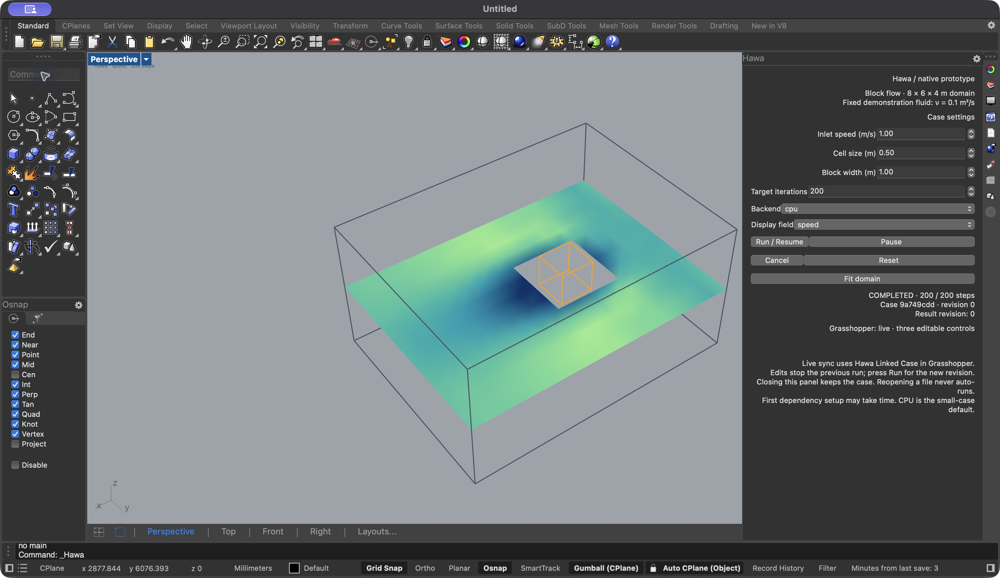
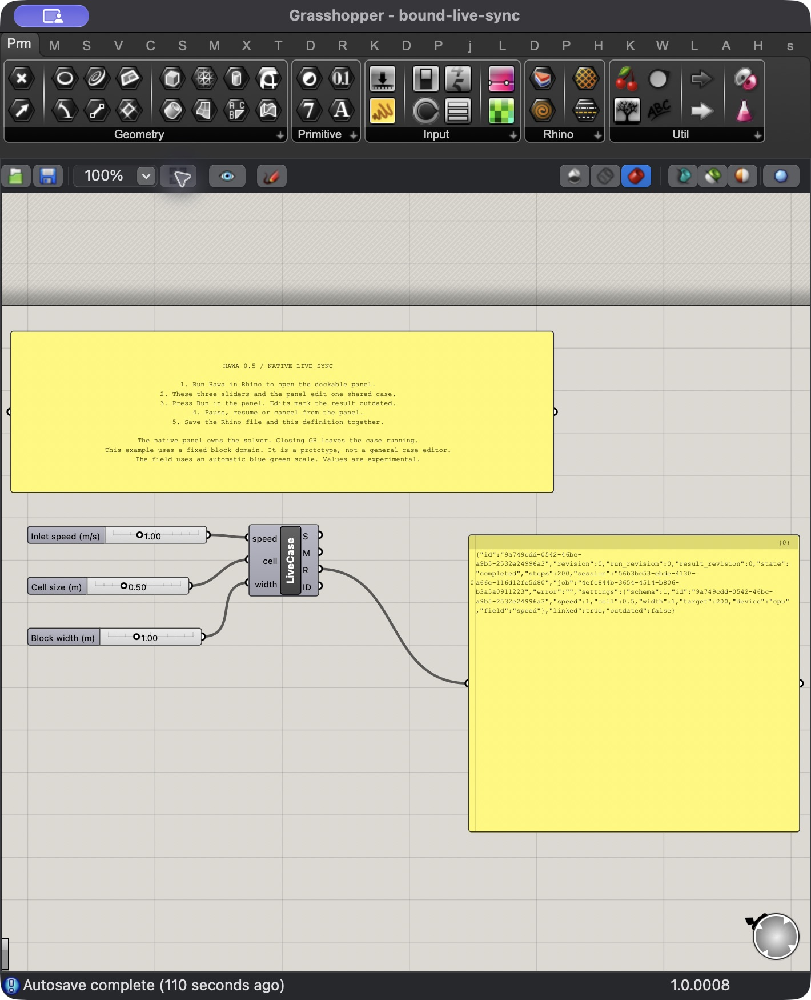

# Hawa 0.5 native prototype

This prototype adds a Rhino dockable panel and live Grasshopper binding to one shared block-flow case per Rhino document. The solver still runs in Rhino's embedded Python 3.9 environment. There is no separate Python process or installation. First use can download the pinned dependencies through Rhino.

## Open the prototype

1. Install the complete Hawa folder in Grasshopper Libraries. Keep `Hawa.Shared.dll`, `Hawa.Rhino.rhp`, the GHA, Bootstrap.py and Python sources together.
2. Load `Hawa.Rhino.rhp` once through Rhino's Plug-in Manager. Restart Rhino normally after replacing a loaded build.
3. Run `Hawa`. Rhino hosts the panel through its standard panel API. It can float or join a docked panel group. The Hawa command reuses its container, or the Layers container on first open. Rhino controls pinning and auto-hide.
4. Select CPU, MPS, auto or CUDA, then press Run. CPU is the default for this small domain. An unavailable explicit backend reports an error.
5. Use Pause, Run / Resume, Cancel or Reset. Target iterations is the total target, not an extra step count.
6. Open `examples/native-prototype/21-native-live-sync.gh` to bind the three sliders. A solver run does not require Grasshopper.

The prototype controls inlet speed, cell size and block width. It uses a fixed 8 × 6 × 4 m extent, a centered block at (3, 3, 2) m, BGK collision, viscosity 0.1 m²/s, density 1.225 kg/m³ and lattice Mach 0.04. The wire domain follows the resolved grid extent when spacing does not divide the requested extent. The viewport uses Rhino model units. Speed, pressure and density are available on a horizontal field slice, with an automatic blue-green scale.

This demonstrates interaction and ownership. It does not establish convergence or engineering accuracy for a physical design.

## Live sync and ownership

- The shared case service owns the solver, background jobs and results. The panel and GH component are views of that case.
- Direct sliders sync both ways. They must cover the documented range with at least two decimal places: speed 0.1–3, cell size 0.25–1, width 0.5–2.
- Calculated inputs drive their parameter. Those fields are read-only in the native panel.
- Only one Linked Case component may write to a case at a time. Closing its definition removes the binding; it does not cancel the native case.
- A physical edit stops the previous job, advances the physical revision and labels retained results outdated. Press Run to solve the new revision.
- A display-field edit preserves the session. It requests a fresh field through the background query service.
- Rhino undo/redo restores case settings and the linked sliders. Job history and intermediate field states are not undo records.
- Closing the panel preserves the case. Closing its Rhino document releases its jobs. Reopening the panel is safe.
- Save the Rhino file and linked GH definition together. The `.3dm` stores settings and case ID, not tensors or a running job. Reopened cases remain idle. A saved linked definition refuses to bind to another case ID. Place a new Linked Case component to bind a different case.

The distributed GH file is an unbound template. On first use, its slider values initialize the three parameters of the active case. The accompanying `native-block.3dm` is a settings example.

## Architecture

`Hawa.Shared` contains the embedded runtime bridge, document case service, revision handling, background-job polling, persistence settings and result mesh construction. Both front ends reference that assembly. `Hawa.Rhino` supplies the registered panel, Hawa command, document archive hooks and viewport conduit. `Hawa.Grasshopper` keeps the existing components and adds Hawa Linked Case.

UI handlers submit work and return. A timer polls job status; numerical work runs in the existing Python worker. The timer only notifies GH when state, steps or field results change. There is no wait loop on the solution thread. First-use language/dependency preparation is a separate Rhino startup operation and can take time.

The panel follows Rhino's [registered panel API](https://developer.rhino3d.com/guides/rhinocommon/tabbed-panels/). Case settings use [plugin document data](https://developer.rhino3d.com/en/guides/rhinocommon/plugin-user-data/). The design uses editable-versus-driven input ownership and completed-result updates from the earlier tool case studies; it imports no code from those tools.

## Prototype limits and next work

This is the bounded 0.5 prototype, not the complete native interface. Arbitrary selected geometry, multiple cases per document, moving-surface editing, optimization setup, full visualization controls and richer legends remain future panel work. Existing GH nodes still provide those workflows. The numerical limitations in the 0.4 closeout remain, including unresolved PorousMedium CPU/MPS parity.

Windows docking, CUDA execution and a clean-machine dependency download require separate hardware/setup checks. Local native tests use macOS Rhino 8 with an existing Rhino-managed Python dependency environment.

See `verification-native-v0.5.json` for measured checks and `closeout-v0.4.md` for the frozen 0.4 release.

## Future idea: additional solver methods (outside 0.5)

Recorded November 8, 2026. This is a research backlog note, with no implementation
or architecture changes required for 0.5 and no committed release date.
The [project roadmap](roadmap.md) develops the shared-case direction and links
the [existing and proposed example catalogue](example-roadmap.md).

Explore a fast particle-based fluid solver inspired by
[Sebastian Lague's Fluid-Sim](https://github.com/SebLague/Fluid-Sim), considering
the physics independently of its rendering. The reference is a Unity project
whose simulation references include SPH literature. A PyTorch implementation
inside Hawa is a candidate to investigate, not an established performance win.

The longer-term direction is a choice of numerical methods: the existing LBM
solver, a possible interactive particle method, and a conventional finite-volume
Navier–Stokes solver along the lines of ANSYS Fluent. The latter is the intended
longer-term engineering CFD direction: assess body-fitted meshes, boundary-layer
resolution, turbulence models (for example RANS), convergence diagnostics and
validated pressure/force predictions. Building a solver versus integrating an
existing engine remains an open scoping decision.

The goal is greater engineering capability and demonstrated accuracy than the
current experimental Hawa implementation. Finite volume is not inherently more
accurate than LBM; accuracy depends on the case, mesh, physical models, boundary
conditions and convergence. See the
[Fluent solver overview](https://ansyshelp.ansys.com/public/Views/Secured/corp/v252/en/flu_th/flu_th_SolveOverview.html)
for its finite-volume approach. Keep numerical method separate from execution
device (CPU, MPS, CUDA) and state the supported physics and validation level for
each method.

Before promoting an idea into development, scope a bounded feasibility study:

- Identify the intended task: liquid/free-surface exploration, external airflow,
  or another specific use case. Suitability for one does not establish the others.
- Define one benchmark, geometry/boundary support, required outputs, and explicit
  exclusions. Separate qualitative flow exploration from validated body loads.
- Set target interaction time, problem size, memory budget, device and numerical
  acceptance criteria before comparing with LBM where the physics overlaps.
- Check neighbour-search cost, stability, conservation, boundary treatment and
  Python 3.9/pinned-PyTorch feasibility; do not assume a Unity GPU implementation
  transfers its speed to PyTorch.
- Time-box the prototype and record a go/no-go decision with measured results.
  Assess reuse of case ownership, background jobs, pause/cancel and result views
  after the numerical experiment, without expanding the 0.5 shared-case API now.

## Local verification

140 Python tests passed; 29 were skipped. Eleven existing GH definitions passed in Rhino. Native tests covered CPU startup without GH, MPS, three-way parameter binding, normal Rhino undo/redo, cooperative pause/resume/cancel, stale results, shared fields, document persistence/isolation, duplicate writers, computed-input ownership, invalid slider ranges, saved-definition rebinding and case cleanup. Pause/cancel submission took 17/34 ms in the recorded run. These are interaction timings, not solver performance benchmarks.

