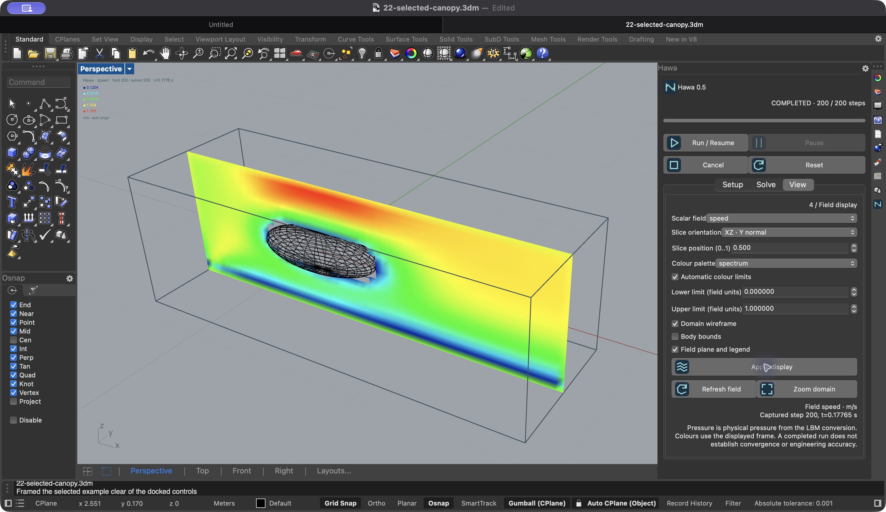

# Hawa 0.5 · native Rhino and Grasshopper

Hawa runs its Python 3.9 / PyTorch LBM engine inside Rhino 8. The native dockable
panel and Grasshopper share one case per Rhino document. First use can download
pinned dependencies through Rhino; users do not need a separate Python install.

## Install and open

Install the complete Hawa folder in Grasshopper Libraries. Keep the GHA,
`Hawa.Shared.dll`, `Hawa.Rhino.rhp`, Bootstrap.py and Python sources together.
Load `Hawa.Rhino.rhp` through Rhino's Plug-in Manager, then run `Hawa`. Quit Rhino
normally before replacing loaded assemblies. The panel uses Rhino's docking
container and can join the Layers group. Its tab and actions have Hawa icons;
buttons retain text labels and tooltips.

## Set up a native case

1. In **Setup**, select valid closed Rhino meshes or solid Breps. Hawa keeps their
   object IDs and suggests an axis-aligned domain around them. Flow is global +X.
2. Set domain origin and lengths in **metres**, independent of Rhino display units.
   Review the padding; it is a setup aid, not a domain-independence study. Keep
   bodies at least two cells from every domain face.
3. Set kinematic viscosity, density, lattice Mach and collision model. Native
   cases use an X− inlet and X+ outlet; choose wall/slip/paired periodic side faces.
   Press **Apply setup** to validate the entire edit.
4. In **Solve**, choose cell size, inlet speed, total target and backend. The grid
   report shows cell count and the storage for FP32 populations alone. Other solver
   allocations need additional memory. Explicit unavailable devices report errors.
5. **Run / Resume** prepares selected geometry in a cancellable background task,
   then starts the embedded solver. **Pause** prevents automatic startup during
   preparation, or requests a cooperative solver pause. **Cancel** releases the
   run. **Reset** also clears results and preserves settings.
6. In **View**, select speed, pressure or density; choose slice orientation and
   relative position; choose blue-green, spectrum or diverging colours. Fixed
   colour limits support comparisons. Apply display changes without restarting
   physics. The legend states field units and automatic/fixed range.

The **Block preset** retains the original 8 × 6 × 4 m demonstration. Its default
viscosity is artificial (0.1 m²/s). Use it for setup and interaction checks, not an
atmospheric-air prediction. Selected geometry uses uniform voxel walls; it does not
silently enable curved-wall interpolation or adaptive meshing.

## Live sync, changes and saved files

Use **Hawa Linked Case** to drive the shared case. Direct sliders sync both ways;
computed inputs are read-only in the panel. The block preset uses three inputs.
For selected bodies, connect speed and cell size and leave block width disconnected.
Selected-case sliders must cover speed 0.001–300 m/s and cell size 0.00001–100 m;
use enough decimals to represent the intended resolution. Only one component can
own the binding. Use the annotated native examples as starting points.

Physical edits stop the prior run and invalidate its results. Editing, replacing
or deleting a referenced Rhino object also invalidates the run. Review geometry
and run again; reselect deleted objects. Unrelated document objects do not affect
this case. Display changes reuse a healthy session. A failed field query has its
own error and Refresh field action. Stale fields are labelled and withheld from
GH mesh outputs. Solver progress and field capture step/time are shown separately.

Save `.3dm` and the bound `.gh` together. Schema 2 stores geometry IDs, domain,
physical settings and display settings; it reads the original schema-1 block
settings. It does not store live workers/tensors. Reopening stays idle. A missing
geometry reference fails explicitly on Run. A saved linked definition refuses a
different case ID. Place a new Linked Case component for another case.

Closing a panel preserves the case. Closing a GH definition releases its binding.
Closing the Rhino document stops its owned work. Use normal Rhino Undo/Redo for
case settings. Job history and intermediate fields are not undo records.

## Supported scope and limits

Native setup is stationary, single-fluid, isothermal, axis-aligned +X flow, with
one case per document. It accepts closed meshes and solid Breps. Grids are bounded
at two million cells, with at least four sites per axis; preview planes are capped
at 65,536 samples. Geometry must be resolved by the lattice. Mesh preparation is
background work; Rhino selection and geometry capture remain host operations.
First runtime/dependency initialization is synchronous and can take time.

Existing GH workflows provide moving bodies, refinement, airfoils, searches,
recording and broader visualization. This release does not add those editors to
the native panel. No free surface, buoyancy, force-driven body motion or thermal
transport is implied. A successful run or attractive field does not establish
convergence or engineering accuracy. PorousMedium CPU/MPS parity remains unresolved.

See the release verification report for the platforms and tests actually run.
Windows docking, CUDA hardware and clean-machine dependency installation must be
reported separately from macOS CPU/MPS results. Read `quality-gates.md` and the
example verification matrix for the maintained review process.

Domain lengths are rounded up to whole lattice intervals for selected geometry;
the viewport wireframe shows the resulting grid extent. The native panel currently
shows scalar slices. Use GH flow lines, isosurfaces and contour components for
broader 3D visualization.

## Verified local build

See [the 0.5 verification record](verification-v0.5.json) for the exact test scope,
platform exclusions and assembly hashes. The expanded panel is shown below.

## Curved solids

Use [23-curved-solid.3dm](../examples/native-prototype/23-curved-solid.3dm)
for the stationary curved-wall workflow. It opens idle with backend Auto. Select
**Interpolated stationary walls** in Setup and Apply setup for your own selected
bodies. Brep tessellation now follows cell size and body extent. Read
[curved-boundaries-v0.5.md](curved-boundaries-v0.5.md) for the measured checks and
limits. Existing mesh shape is preserved. Grid Preview shows discrete lattice
sites even when wall positions lie between them.
