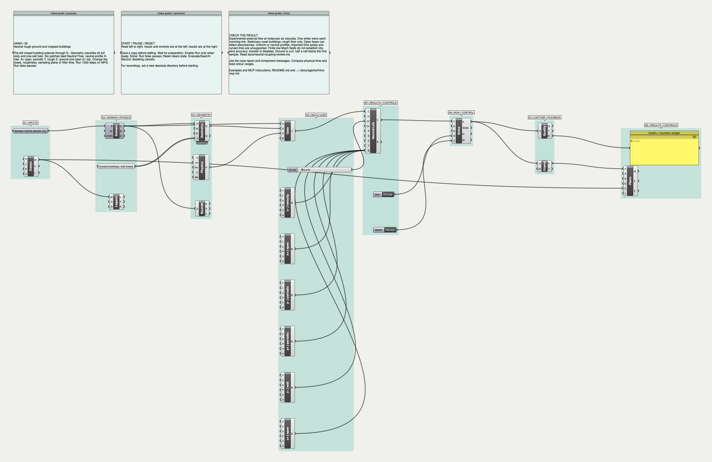
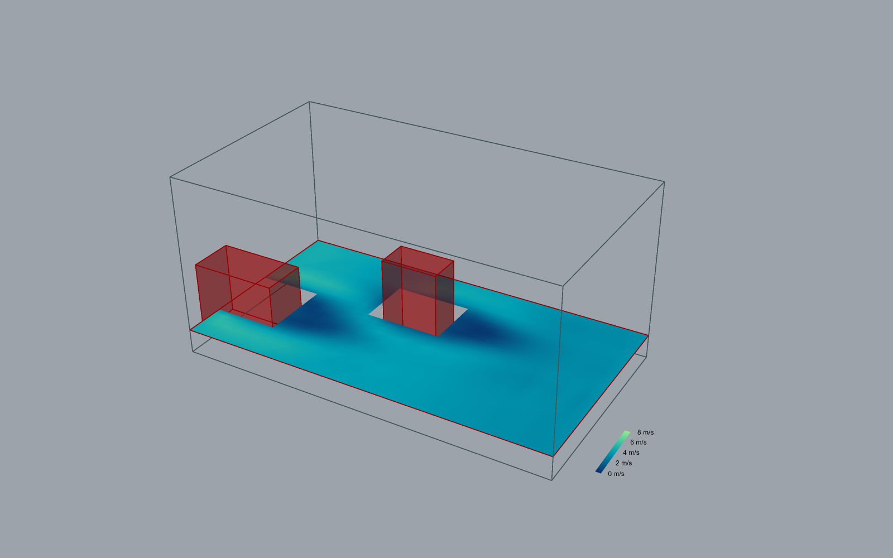
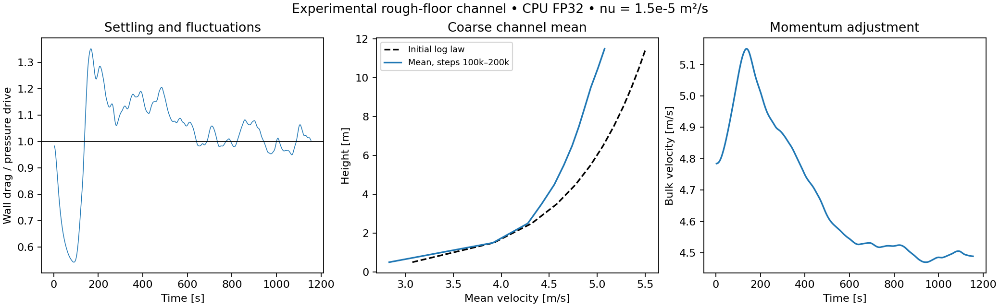

# Neutral flow: settling, rough walls and cropped open boundaries

November 9, 2026. Implementation and G0–G5 review: Codex, self-review. Development
work; atmospheric engineering qualification and public release remain open.
This follows [the original precursor record](neutral-precursor-review.md).

## Diagnosis and changes

The original 24³ test exceeded its 5% startup-profile drift limit at 11.55 s.
That failure is retained. An initial logarithmic velocity with equilibrium
populations has no turbulent Reynolds stress and initially negligible SGS stress.
It cannot supply the height-dependent shear needed to balance pressure forcing.
The early profile must adjust. Startup preservation is therefore not an appropriate
steady neutral-channel acceptance test.

The rough wall now supports a specified sampling plane and an exponential time
filter of its reference velocity. Both are explicit case parameters. Filter
history is part of the checkpoint and reset contract. Defaults preserve previous
precursor archives. The original viscosity, collision guard and test tolerances
are unchanged. Neutral cases continue to report their experimental model status
and remain ineligible for boundary transfer.

External mode uses the same physical patch schema, shifted collision and rough
floor. Geometry classifies a one-cell solid halo from the complete closed source
body. A building can extend through an open/velocity face. Each missing D3Q19
population has one owner: halo solid, exterior condition, or floor/lid. The body
uses halfway bounce-back; curved links and moving bodies remain unsupported here.

At ground/open corners, an exterior face can own one diagonal of a rough-wall
correction pair. The old paired correction then adds mass. The new operator
allocates the requested tangential impulse among available links and balances
their mass on the normal link. Diagnostics report the impulse actually applied.
The global fluid-mass balance measures external population exchange. Summing
shifted populations avoids subtracting large, nearly equal FP32 absolute masses.

A convected shear-pulse comparison exposed an outlet defect (HAWA-017). Same-node
reconstruction retained 18.28% of the initial disturbance. An interior donor alone
retained 16.45%. The corrected outgoing branch uses a one-sided convective update
at the measured outward velocity, plus the supplied pressure reference. The
incoming branch uses the specified exterior velocity. The final error is 2.34%
against a doubled-domain reference; the original limit remains 10%.

All exterior links are batched into one tensor update. Against the previous
per-direction implementation, 40-step CPU64 population differences were zero and
2.42e-17 for the internal/cropped building cases. This removes repeated GPU
synchronization. It does not change the ownership or reconstruction equations.

## Contracts and limits

- `neutral_precursor.mode`: `precursor` (default) or `external`.
- `wall_sample_index`: zero-based interior Z plane; physical height `(index+.5)dx`.
- `wall_filter_seconds`: nonnegative; zero disables filtering.
- External mode requires `boundary_method: shifted-links-v1` and six patches.
  Ground is stationary rough Z−. Z+ supports slip, velocity or open. Horizontal
  faces support velocity, open or paired periodic conditions.
- Velocity/open profiles support `uniform` or `neutral`. Nonzero open gauge
  pressure is respected; relative imposed density deviation is limited to 2%.
  Exterior velocity must fit the conservative lattice Mach 0.10 budget.
- Adjacent prescribed velocity faces must agree. Buildings must clear periodic
  seams. Ground sampling inside an overhang/solid is rejected. Halo interior must
  equal the solid mask. Unsupported profiles and moving ground reject explicitly.
- A missing inward axial donor at a cut building uses the local fluid state;
  solid populations never supply exterior data. This local fallback needs further
  separated-flow accuracy assessment.
- Open faces can reflect waves. The pulse test covers one smooth convected
  disturbance, not a general nonreflection claim. Building walls are stationary
  voxel boundaries. Equilibrium rough-floor stress is not a validated model of
  separated near-building surface traction.
- Imported boundary series, refinement, thermal stability and water motion are
  outside this mode. Multi-face atmospheric transfer remains a separate open
  item in [the delivery checklist](atmosphere-delivery.md).

## Numerical tests

Criteria were declared in the harnesses before the final runs.

| Check | Setup / criterion | Result |
| --- | --- | --- |
| Rough-wall analytic channel | Cs=0, nu=0.1 m²/s; 12/24 Z cells; initialized analytic profile; relative profile and drag errors <=0.1% | PASS; profile errors 2.90e-6 / 1.31e-6; drag errors 2.82e-5 / 1.66e-5 |
| Advected shear pulse | 32 versus 64 X cells, 1600 steps, CPU64; velocity Linf error / initial pulse amplitude <=10% | PASS; 2.34% |
| Link mass balance | Cropped/internal buildings and rough/open corners, CPU64 | PASS; residual <1e-10 lattice units |
| Device comparison | Cropped building, 40 steps, CPU/MPS; atol 5e-5 m/s, rtol 5e-4 | PASS |
| Sampled/filtered restart | Save, advance, reload and repeat | PASS; identical CPU populations |
| Stationary rough channel | Separate settling/averaging, 2% successive-profile change, 5% mean drag/drive mismatch, 5% log-law probe error | PASS at 200,000 CPU steps: 1.40% profile-window change, 3.05% drag mismatch, 1.09% log-law probe error |

The analytic reference solves `nu U'' + g = 0`, zero lid shear and the same wall
stress relation at sampling height zs:
`U(z)=u* log(1+zs/z0)/kappa + (g/nu)[H(z−zs)−(z²−zs²)/2]`.
It verifies the force/wall implementation. It is a laminar constitutive test,
not external atmospheric validation.

The 72×36×12, dx=1 m stationary test keeps nu=1.5e-5 m²/s, Uref=5 m/s at 6 m,
z0=.01 m, Cs=.17, Ma_ref=.05, sample index 1 and filter time 3 s. Each averaging
window contains 10,000 steps sampled every 500. The coarse 0.1H–0.25H interval has
only one independent plane after excluding the wall sampling plane; its profile
metric is a **log-law probe**, not a resolved log-layer fit. Experimental data,
spatial refinement and turbulence-spectrum qualification remain required.

At 100,000 MPS steps (577.35 s), successive mean profiles changed 1.04%, the
log-law probe error was 0.53%, and mean drag mismatch was 5.33%. That run still
failed the 5% drag target. The subsequent checkpointed CPU run completed 200,000 steps (1154.70 s) and passed
all three unchanged criteria. Windows of 30,000 and 50,000 steps also satisfy the
profile-change and drag criteria. Over steps 100k–200k, mean drag mismatch is 1.47%;
the measured bulk acceleration and drive-minus-wall acceleration differ by 0.082%
of the imposed acceleration. This budget uses sampled wall history, so quadrature
error remains. The original 100k MPS failure is retained.

Reproduce with the repository Python:

```sh
.venv/bin/python -m pytest tests -q
.venv/bin/python scripts/verify_neutral_coupling.py --output results/new-coupling.json
.venv/bin/python scripts/verify_neutral_stationary.py --device cpu --steps 200000 --output results/new-stationary.json
dotnet run --project tests/dotnet/StateContracts
```

Local raw evidence: `results/atmosphere-coupling/`. Failed intermediate numerical
reports are retained separately. The tracked JSON summary records final counts, devices, measurements, omissions
and source hashes.

## Grasshopper workflow

[30-neutral-cropped-buildings.gh](../examples/grasshopper/30-neutral-cropped-buildings.gh)
is a reusable assembly of existing geometry, domain, physics, patches, Solve,
Snapshot, Quality and view operations. The building boxes are ordinary GH data.
The renamed **Hawa Neutral Flow** component retains the precursor GUID and old
input indices, and appends wall sampling, filter time and optional external
patches. Existing examples 28–29 retain precursor behavior.

The new example has a 32×18×16 grid at 1 m spacing, molecular air viscosity, a
5 m/s reference wind at 6 m, a building crossing X− and an interior building.
X− is neutral-profile inflow, X+ and Z+ are open, Y is periodic and Z− is rough
ground. The source definition is saved with Run=false. Its 1000-step run is a
workflow demonstration, not a settled urban result.



## Research and attribution

- [PALM boundary conditions](https://docs.palm-model.org/25.10.1/Reference/LES_Model/Boundary_Conditions/): precursor adjustment and turbulent inflow need explicit treatment.
- [UMD wall-stress models](https://wmles.umd.edu/wall-stress-models/wall-model-algebraic/): equilibrium wall laws use assumptions about the sampled boundary layer.
- [lbmpy boundary documentation](https://pycodegen.walberla.net/docs/lbmpy/1.4/sphinx/boundary_conditions.html): wall sampling/filtering and extrapolation outflow provide relevant design references.
- [Latt and Chopard](https://arxiv.org/abs/physics/0506157) and [Han et al.](https://arxiv.org/abs/2009.04352): regularization and population-based wall stress. Their validation does not transfer automatically to this combination.

Equations and code were implemented independently. No source or dataset was
copied. Original additions remain GPL-3.0-only; bundled notices are preserved.

## Host follow-up

Example 30 completed 1000 steps on embedded MPS (5.773503 s), max lattice Mach
0.074773, no component errors, 743 valid slice faces. Snapshot iteration/time
matched completion. The geometry produced 205 solid indices and 264 halo indices.
Cooperative pause acknowledged, invalid z0 produced a preflight error and zero
field faces, and repair recovered. A CPU run then completed 400 steps. Closing
during a long CPU run left PendingCleanupCount=0. Examples 28 and 29 each ran
400 MPS steps with 841 valid slice faces on this build.

The all-example archive audit then exposed missing appended input chunks in old
precursor files (HAWA-018). The existing append-only migration mechanism now includes
the precursor's original 6/2 parameter counts. Live archive tests pass for 28–30:
zero missing-chunk warnings, original parameter GUIDs/wires preserved, correct
new defaults, and successful save/reopen. Source graphs retain their IDs, wires and saved idle controls.



## Gate decision

All reviewers below are the same Codex agent performing separate self-review
passes. No independent specialist approval is claimed.

| Gate | Decision | Evidence / limits |
| --- | --- | --- |
| G0 research | PASS, bounded method scope | Primary sources above; shifted storage, equilibrium wall assumptions, convective outflow |
| G1 architecture | PASS | Versioned mode/storage, shared patch contract, single link ownership, halo validation, filtered restart state, append-only archive migration |
| G2 reliability | PASS, executed matrix | 209 passed / 31 skipped / 4 existing warnings; StateContracts 33; lifecycle and archive regressions |
| G3 physics | PASS for listed verification; atmospheric validation OPEN | Analytic wall, pulse, mass/impulse identities, CPU/MPS parity, unchanged stationary criteria; one coarse log-law probe |
| G4 examples | PASS for 28–30 | Live embedded runs, valid field time/meshes, pause/error/recovery/close and source archives; 30 annotated |
| G5 development integration | PASS for local development bundle; release BLOCKED | Tested source/binaries packaged; Windows/CUDA, clean install and atmospheric qualification remain open |

[Tracked measurements and hashes](verification-neutral-coupling.json). Isolated
reference and backport suites each report 419 passed / 884 skipped / 40 warnings.
The compatibility-matrix gate requested during this work is a separate follow-up;
these scoped results do not count as its exhaustive inventory.


