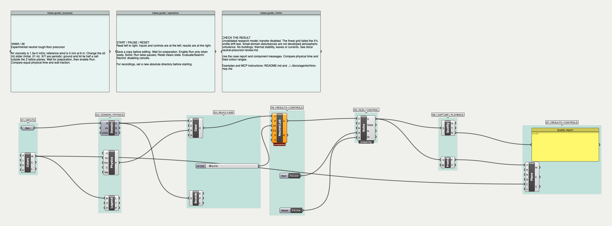
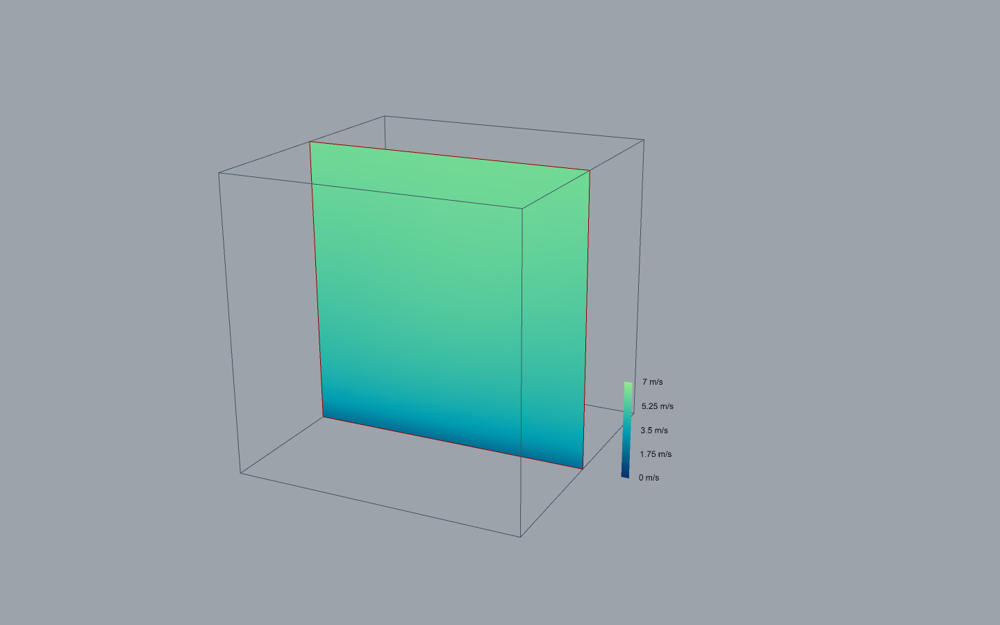

# Experimental neutral precursor: implementation and failed qualification gate

> Follow-up: [neutral coupling and settling review](neutral-coupling-review.md) adds sampled/filtered walls, building/open boundaries and a replacement stationary test. The failed startup evidence below is preserved.

November 9, 2026. Author and reviewer: main Codex agent, self-review across G0–G5.
This is a development implementation, **not a completed atmospheric release**.
The full authorised delivery remains tracked in [the delivery record](atmosphere-delivery.md).

## Implemented

- Explicit `neutral_precursor` schema 1 and `shifted-regularized-sgs-v1` collision.
  Molecular viscosity stays at the supplied value. Store `g=f-w`; compute the
  small relaxation increment separately with a rationalised SGS quadratic root.
  The regularized second-moment collision retains that increment without first
  rounding the whole relaxation time to 0.5. This improves representation; it is
  not proof of resolved molecular dissipation at every coarse-grid condition.
- Exact-difference pressure-gradient forcing. Reported physical velocity includes
  the half-force correction. Pressure uses the stored density deviation directly.
- Planar halfway rough-floor stress and free-slip lid with periodic horizontal
  directions. Specular reflection includes tangential streaming displacement.
  Paired diagonal population corrections impose the prescribed wall impulse
  without adding mass. Report applied stress and wall population-mass exchange.
- Neutral mean initialization and a deterministic divergence-free horizontal
  disturbance. The disturbance is an initial condition, not a validated turbulent
  inlet. Reference heights/roughness use metres above the aerodynamic plane.
- Explicit checkpoint population-storage identity and matching density validation;
  reset/load clear wall diagnostics. A regression exposed and fixed the old
  absolute-population density check rejecting shifted checkpoints.
- Experimental **Hawa Neutral Precursor** component with an icon, asynchronous
  preflight, explicit opt-in and warning. Its input is a Case assembled from the
  existing Domain and Physics nodes. Existing archives keep their existing solver.
- [28-neutral-rough-floor.gh](../examples/grasshopper/28-neutral-rough-floor.gh)
  and [29-neutral-roughness-sensitivity.gh](../examples/grasshopper/29-neutral-roughness-sensitivity.gh).
  Both are annotated, editable, idle on disk and use ordinary Solve/Snapshot/Plane
  Field/Legend/Quality components. Example 29 changes z0 from 0.01 to 0.1 m.

The mode currently rejects bodies, moving/curved walls, imported boundary fields,
general open boundaries and refinement. It is a homogeneous precursor, not a city
case. The rough wall lies half a cell outside the first lattice plane; the lid is
half a cell outside the last. The Domain wireframe marks sample-centre bounds.
Atmospheric validation is false and transfer eligibility is false even when the
low-Mach health check passes. Existing legacy relaxation guards remain in place.

## Verification evidence

Executed checks: **197 passed / 31 skipped** in the Hawa suite; **33 passed**
in StateContracts; isolated upstream reference and backport each **419 passed /
884 skipped / 40 warnings**. Existing MRT warnings remain. These counts do not
convert the failed atmospheric gate into a pass.

Tests in `tests/test_neutral.py` cover shifted equilibrium moments, absolute versus
shifted regularized collision in CPU64, per-step mass and tangential impulse
balance including forcing, reversal/rotation, CPU/MPS versus CPU64, physical-air
spacings 0.1/1/10 m, invalid combinations, reset and checkpoint round-trip.

The 100-step device comparison uses velocity atol=3e-5 m/s, rtol=3e-4; the CPU64
wall/drive identities use atol=2e-14 lattice units. These are implementation tests,
not atmospheric accuracy tolerances. Tests retain explicit unverified CUDA skips.

`verify_neutral_precursor.py` tests 12³, 16³ and 24³ lattices over the same 12 m
physical height, Uref=5 m/s at 6 m, z0=0.01 m, nu=1.5e-5 m²/s, Ma=0.05,
Cs=0.17. It compares the lower-quarter profile, excluding the first cell, at
11.547 seconds. The predeclared <=5% relative L2 drift target produced:

| Grid | CPU | MPS | Decision |
| --- | --- | --- | --- |
| 12³ | 3.54085% | 3.54085% | PASS for this short test |
| 16³ | 4.41010% | 4.41010% | PASS for this short test |
| 24³ | 5.41823% | 5.41827% | **FAIL** |

The harness exits 2 and records `profile_preservation_pass: false`. The threshold
was not widened. A finite, stable channel does not establish a suitable atmospheric
profile. This is a startup-profile gate; it is not an experimental reference or
proof that a periodic forced channel must maintain its initial log law forever.

A longer MPS adjustment run used 72×36×12 cells, dx=1 m, 20,000 steps,
115.470 seconds (172.24 wall seconds on this machine). Final local lattice Mach
was 0.065682, relative mass change −2.512e-7. Resolved spatial variances averaged
over height were approximately [0.12462, 0.03928, 0.02686] m²/s². These are
instantaneous spatial statistics, not converged temporal Reynolds stresses.
Final mean floor traction was −0.07468 Pa streamwise. The mean profile continued
to adjust; this run cannot certify developed neutral turbulence.

Full local evidence is under `results/neutral-precursor/`: source test logs,
profile reports, adjustment history, live host reports and build logs. The longer
experiment and profile reports precede the final diagnostic-only addition of wall
mass exchange; that addition changes no populations or physical fields.

## Host verification

Rhino 8.36, macOS, embedded Python 3.9 / PyTorch 2.8, MPS. Each example completed
400 steps = 2.309401 seconds with no component errors and one valid 841-face field
mesh. Field Snapshot iteration/time matched the completed solver. Both source
files retain Run=false. Source annotations preserve functional objects and wires.

Example 28: long run → cooperative pause; invalid z0 → preflight error and zero
field faces; valid input → recovery; close during a long run → cleanup count zero.
Example 29 was opened from the annotated file and run separately. Rhino was quit
normally for installation, never killed. One missing MCP slot was readopted at the
same PID; it was not a Rhino crash.

## Gates and remaining work

| Gate | Decision | Evidence / limitation |
| --- | --- | --- |
| G0 research | PASS for bounded implementation | Sources below; no claim of urban validation |
| G1 architecture | PASS for experimental contract | Separate mode/storage, strict capabilities, no archive reinterpretation, transfer blocked |
| G2 reliability | PASS for executed checks | Unit/integration suite, checkpoint regression, host failure/recovery and disposal |
| G3 physics | PASS for bounded identities; **FAIL for atmospheric qualification** | Profile drift on finest grid; no converged/experimental atmospheric comparison |
| G4 UI/UX | PASS for two experimental workflows | Actual Rhino runs, valid fields, annotated definitions, warnings and lifecycle checks |
| G5 release | **BLOCKED** | Atmospheric qualification incomplete; CUDA/Windows unverified; development bundle only |

Required follow-up within the already authorised task: establish settled precursor
statistics and grid/domain sensitivity, verify the wall sampling/filter treatment
and total-stress profile against a suitable neutral-channel reference, then add
and verify open/cropped-building coupling and multi-face transfer. The current
short profile failure must be resolved or replaced with a scientifically justified
benchmark decision retaining this failed evidence. Do not tune forcing, viscosity
or a threshold merely to preserve an arbitrary initial profile.

## Primary references and attribution

- [Lehmann et al., precision and shifted distributions](https://link.aps.org/doi/10.1103/PhysRevE.106.015308): shifting removes the large background population from storage. This does not establish a high-Re operating envelope for Hawa.
- [Latt and Chopard, regularization](https://arxiv.org/abs/physics/0506157): reconstruct non-equilibrium populations from their second moment. The implemented SGS and forcing combination needs its own verification.
- [Han, Ooka and Kikumoto, wall-function bounce](https://arxiv.org/abs/2009.04352): wall stress modifies populations; their smooth-wall channel validation is not validation of this rough-floor implementation.
- [lbmpy wall treatment](https://pycodegen.walberla.net/docs/lbmpy/1.4/sphinx/boundary_conditions.html): documents sampling/filtering choices and cautions against instantaneous reference velocity. Hawa currently uses instantaneous first-cell velocity; this remains a qualification issue to investigate.

Equations were implemented independently; no external code or datasets copied.
Original additions remain GPL-3.0-only. Existing upstream notices remain intact.
