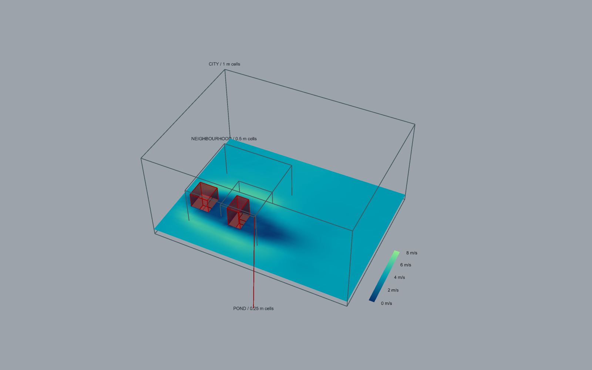
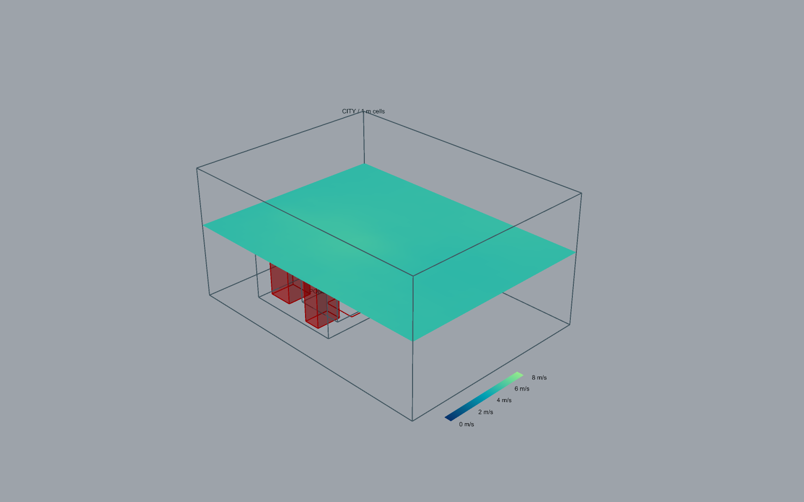

# Neutral transfer, shared views and retained GH polling

November 9, 2026. Author/reviewer: Codex, separate self-review passes. This is a
development increment, not an atmospheric release. The fixed numerical criteria
are in [the completion contract](atmospheric-nesting-implementation.md).

## What changed

BoundarySeries v2 permits neutral external cases to consume timed velocity,
pressure and kinetic strain on every active exterior face. It maps initial state,
tracks absolute time, validates geometry/model/source provenance and preserves
compatible rough-wall filter memory. v1 remains readable. Roughness and Flow
Statistics are reusable operations; the three-stage layout is ordinary GH content.

Plane Field, Flow Display, Isosurface and Surface Field accept multiple immutable
frames. The finest containing grid owns each sample, including its solid mask.
Views reject inconsistent time/reference data and preserve disjoint gaps. Plane
faces are trimmed at halfway solid boundaries. The retained fluid portion uses
reconstructed boundary colours; raw sample validity remains conservative.
Curved-link and derivative-field reconstruction is explicitly excluded here.

Example 33 exposed a lost-refresh defect: the pond worker completed while its GH
component stayed running. McNeel documents that another solution can erase a
[GH ScheduleSolution request](https://developer.rhino3d.com/api/grasshopper/html/Overload_Grasshopper_Kernel_GH_Document_ScheduleSolution.htm).
Polling now uses an owned [Eto UI timer](https://pages.picoe.ca/docs/api/html/T_Eto_Forms_UITimer.htm),
with retained component/document/job identities, per-document batching, disabled
solution checks, observer fault isolation and explicit cancellation on disposal.
This timer works without the native panel's timer. Slider-write/binding callbacks
retain their separate pre-solution contracts; this change does not redesign them.

## Evidence and decisions

| Gate | Decision and scope | Evidence |
| --- | --- | --- |
| G0 research | PASS for declared development scope | Fixed acceptance contract; McNeel/Eto APIs; AIJ attribution; published boundary/nesting methods below. No proprietary implementation copied. |
| G1 architecture | PASS for bounded transfer/view/poll contracts | Versioned files, time/provenance checks, immutable captures, allocation limits, same-time finest ownership, old port identities/wires retained. Physical one-way nesting remains a separately failing claim. |
| G2 reliability | PASS on available local devices | 600 Python tests, 32 CUDA skips, four existing MRT warnings; 33 state contracts. Seven focused collection tests cover clipping area, rotation, raw masking, time, disjoint gaps, reference-example frames, cancellation and budgets. |
| G3 numerical physics | FAIL for atmospheric and nested statistical qualification | Manufactured transfer/operator checks pass; long AIJ/nested comparisons below fail unchanged thresholds. Finite fields do not close this gate. |
| G4 host/UI | PASS for the recorded development workflows | CPU and MPS example 33; automatic dependencies, pause/resume, intervening display solution, saved-enabled reopening, file failure/recovery and shared views. Detailed machine record accompanies this review. |
| G5 integration/release | BLOCKED for public atmospheric release | Development bundle only. G3 failures, unavailable CUDA/Windows and clean-machine installation remain open. No public publish/commit/push is part of this increment. |
| G6 finite compatibility | PASS locally; CUDA BLOCKED | 102,459 declared rows: 100,010 pass, zero fail, 2,449 blocked. Current source/test-ID integrity passes. 54 public nodes in 31 annotated definitions; 191 observed port combinations. |

The test logs are under `results/atmosphere-nesting/`: `suite-final.log`,
`pytest-final.xml`, `state-contracts-3.log`, `matrix-trim-final/`,
`evidence-final.json`, `archives-build9/`, `live-33-4/` (CPU) and `live-33-5/`
(MPS). These are local evidence artifacts. The compact tracked record is
[verification-neutral-transfer.json](verification-neutral-transfer.json).

The archive checks preserve original parameter GUIDs and wires, append defaults,
and migrate the four Frame inputs to lists. All 31 supported definitions round-trip;
legacy 09 remains untouched. This is not a fresh numerical run of every old example.

## Live reproduction

Use [example 33](../examples/grasshopper/33-neutral-city-to-pond.gh) and its guide.
The shipped source is idle. Set three new recording directories and two new
boundary-file paths, then enable the five stage controls. CPU and MPS both complete
512/1024/1792 steps at the same final absolute time, 2.9560333782508845 s. All three
plane meshes and quality/statistics reports are present. The short histories
correctly report insufficient statistical evidence.

The pond starts after 0.3695041722813605 s of neighbourhood startup. Earlier
neighbourhood pressure exceeds the stricter 2% mapped-density limit and is rejected.
Changing physics or the selected window requires matching duration and playback
time. Do not loosen the guard to make a demonstration run.

The MPS check pauses the pond at zero steps, changes the slice, and resumes.
Shared views produce seven 3D curves, a valid pressure isosurface and masked
surface samples. Moving the slice to z=9 m produces a valid parent-only extent
above both children. Missing-file input withholds output; restoring the file and
incrementing Reload recovers. Saved enabled controls reopen idle. Closing the owned
definition leaves zero jobs, sessions, workers and pending refresh requests.

The retained-cleanup fault injection also passes Solve/query, Evaluate, Record,
Refined Solve and Motion Evaluate with the native timer disabled. Failed transport
closes remain owned, then recover to zero jobs/sessions/workers. The first audit
timed out on stale harness display-text matching; the corrected harness reads the
State output, and the failed audit remains under `cleanup-build9/`.

## Numerical disposition

The current wall/pulse checks retain molecular viscosity and model constants.
Two analytic rough-wall grids have profile relative L2 below 3e-6 and drag error
below 3e-5. The enlarged-domain pulse comparison has 4.45% relative Linf error
against a 10% criterion. These verify bounded operators, not urban turbulence.

The current 60,000-step, 6-cells/H MPS AIJ comparison passes its predefined
streamwise hit-rate and stationarity checks: 66/91 hits (72.53%) and 1.83%
stationarity change, over 16.98089 s. Its TKE relative L2 error is 95.26%. This
is a bounded mean-flow result, with grid sensitivity and turbulence still open.

The current 4-cells/H AIJ cube at 40,000 CPU steps gives 59/91 streamwise hits
(64.84%; 66% required), despite passing its 2.58% stationarity check. The older
8-cells/H run gives 69/91 hits but fails 5% stationarity at 5.44%. Resolved TKE is
poorly reproduced. The fixture uses measured mean inflow and an initial disturbance;
it does not supply sustained measured inlet turbulence. Do not claim that it does.

In the long 1:1 nesting check, mean error is 0.34% but component-RMS error is
14.60% and reference stationarity is 13.26%. The 2:1 comparison against a full
fine-domain reference has 13.34% mean error and 127.57% RMS error. A longer 1:1
window still fails. Copying compatible wall-filter history fixes the initial
state discrepancy but does not repair these long statistical differences.

Remaining work is to qualify inlet turbulence, stationary averaging and nested
stress transport across resolution changes. Failed runs remain recorded; HAWA-021,
HAWA-022 and atmospheric delivery items stay open. No tolerance was widened.

## Numerical references and attribution

- [AIJ Case I dataset](https://doi.org/10.5281/zenodo.15430018): Kondo, Mutou and
  Hori; editors Tominaga, Kikumoto and Okaze. CC BY 4.0. Files/checksums/attribution
  are in `tests/reference_data/aij-case-i/`; no site scraping or API dependency.
- [PALM nesting study](https://gmd.copernicus.org/articles/14/3185/2021/index.html):
  boundary interpolation, mass consistency and turbulence adjustment motivate
  separate checks. No PALM code copied.
- [Wissocq et al.](https://arxiv.org/abs/1701.07734) and
  [Latt et al.](https://doi.org/10.1103/PhysRevE.77.056703): published kinetic
  boundary reconstruction references. Hawa's constrained projection is original.
- [OpenFOAM pressure inlet/outlet velocity documentation](https://doc.openfoam.com/2306/tools/processing/boundary-conditions/rtm/derived/inletOutlet/pressureInletOutletVelocity/):
  normal-flow/tangential-backflow behavior informed the explicit pressure mode.
  It is not a nonreflecting characteristic boundary claim.

Original Hawa source remains GPL-3.0-only. Bundled upstream notices remain intact.
