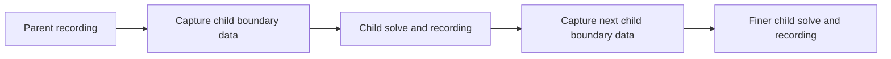

# Parent and child flow domains

Use **parent** for the domain supplying recorded boundary data and **child** for
the separate domain consuming it. A child can cover a smaller region with finer
cells. In a chain, the middle domain is a child of the first and a parent of the
last. These names describe data flow; they do not select a physical model.

A broad surrounding domain → a local study region → a detailed region of interest
is the general organization. The city/neighbourhood/pond names in example 33 are
one atmospheric application of that organization. They do not add a water solver,
and the finer result is not automatically more accurate.

## Choose the operation you need

| Operation | What advances the solution? | Who owns the data? | Current scope |
| --- | --- | --- | --- |
| Offline one-way boundary transfer | Run and record the parent, capture its data for a child, then run the child as a separate case. The child does not update the parent. | Each case owns its solver and recording. The boundary file identifies its source and the child mapping. | Example 24 demonstrates bounded v1 X− velocity import. Example 33 demonstrates experimental neutral v2 multi-face transfer. Their physical models and acceptance limits differ. |
| Coupled refinement | Refined Solve advances a parent grid and one fixed 2:1 patch together; the fine grid takes two steps per coarse step. | The refinement operation manages both grids and their exchange; separate result frames describe each grid. | Example 15. Restricted BGK/geometry combinations, no arbitrary levels or moving patch, and no exact conservative refluxing. Compare a uniform fine-grid reference. |
| Composed field views | No solver advances. Views read immutable frames at the same absolute time. | The finest containing domain owns each displayed sample, including its solid/invalid mask. Equal spacing uses input order. | Plane Field, Flow Display, Isosurface and Surface Field accept supported multi-frame input. This does not couple simulations or validate their agreement. |

For a recorded parent/child chain, the data flow is:

Each downstream run depends on usable upstream data and a matching time window.
The diagram shows offline transfer, not simultaneous refinement. Start with the
[example 24 guide](boundary-transfer.md) for its bounded wake case, or the
[example 33 instructions](../examples/grasshopper/README.md#33--three-stage-neutral-boundary-transfer-development)
for the current three-stage atmospheric demonstration.

## Read example 33 without the geographic names

The existing archive and its canvas retain their original labels. Use this map
while reading them; the file is still `33-neutral-city-to-pond.gh`.

| Role | Existing canvas label | Grid sample counts | Cell spacing |
| --- | --- | --- | --- |
| A: outer parent | `A / city` | 32 × 24 × 16 | 1 m |
| B: local child of A, parent of C | `B / neighbourhood` | 24 × 24 × 16 | 0.5 m |
| C: finer child of B | `C / pond` | 24 × 24 × 16 | 0.25 m |

These are grid sample counts, not domain lengths in metres. The displayed sample
extent runs from the first to the last sample centre; the stationary ground is
half a cell below its first centre. The example reclassifies the same closed
building geometry on each grid. Its finest region remains **air over a
low-roughness ground patch**, with no water circulation or free surface.

The example uses separate recordings and boundary files. Save a copy and follow
the linked instructions for fresh paths, controls and the supplied capture window.
Those settings have recorded workflow evidence; changing them requires checking
coverage and quality again. Keep the source archive idle and preserve its wires,
object identities and parameters.

## Before running a child

1. **Check the physical case.** Confirm the intended solver, material, boundaries,
   world placement and units on each grid. Calling a case a child does not make an
   unsupported model or boundary combination valid.
2. **Check resolution and geometry.** Record cell spacing separately from surface
   mesh detail. The child owns its local geometry/solid classification. Capture
   must cover the required fluid samples; do not fill missing data through solids
   or remove guards to force an import.
3. **Check source identity and time.** Use a completed parent recording, the
   matching child mapping and a fresh boundary file. Inspect the source report.
   Child time must fit the recorded source window; the same iteration number on
   different grids does not imply the same physical time. Boundary Data requires
   Reload after replacing its file and rejects a changed file through an old case.
4. **Check eligibility and statistics separately.** A completed job or finite
   field is not proof of settled flow, turbulence accuracy or convergence. The
   experimental neutral path still requires its explicit opt-in and quality
   checks. Inspect means/RMS and reference comparisons before interpreting a result.

## Compare results without hiding gaps

For a composed view, select frames at the same **absolute physical time**. Do not
mix instantaneous and mean frames; pressure/Cp views require matching pressure
references. The first frame supplies the common Cp reference speed and density,
so choose it deliberately. Keep colour ranges fixed for comparisons.

The finest containing frame owns a sample even when that sample is solid or
invalid: a coarser frame does not fill through its mask. Outside all frames there
is no data; disjoint regions do not acquire a simulated bridge. Reconstructed
boundary colours are display values, distinct from raw sampled values/validity.
A smooth combined picture does not demonstrate continuity or conservation between
separate solves. See the [view and transfer review](neutral-transfer-review.md).

## Qualification limits

The three-stage data path and views have historical CPU/MPS host evidence. The
long nested statistical comparisons still fail their fixed criteria. In the
recorded 2:1 comparison, mean/RMS errors are 13.34%/127.57% against 5%/10% limits;
the 1:1 comparison also fails RMS and stationarity criteria. These are retained
failures, not new measurements or validated atmospheric predictions.

HAWA-021/022 track those numerical gaps; HAWA-009 tracks broader refinement.
Read the [acceptance contract](atmospheric-nesting-implementation.md) and
[recorded results](neutral-transfer-review.md#numerical-disposition). This guide
changes terminology and navigation, not the available physics or qualification.
