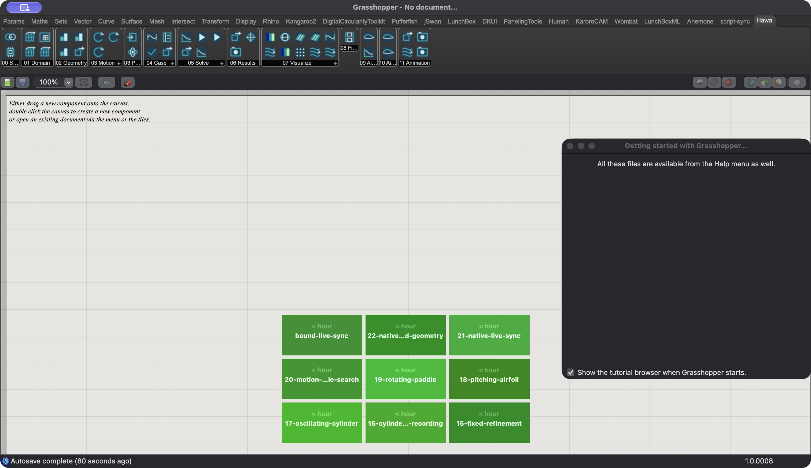
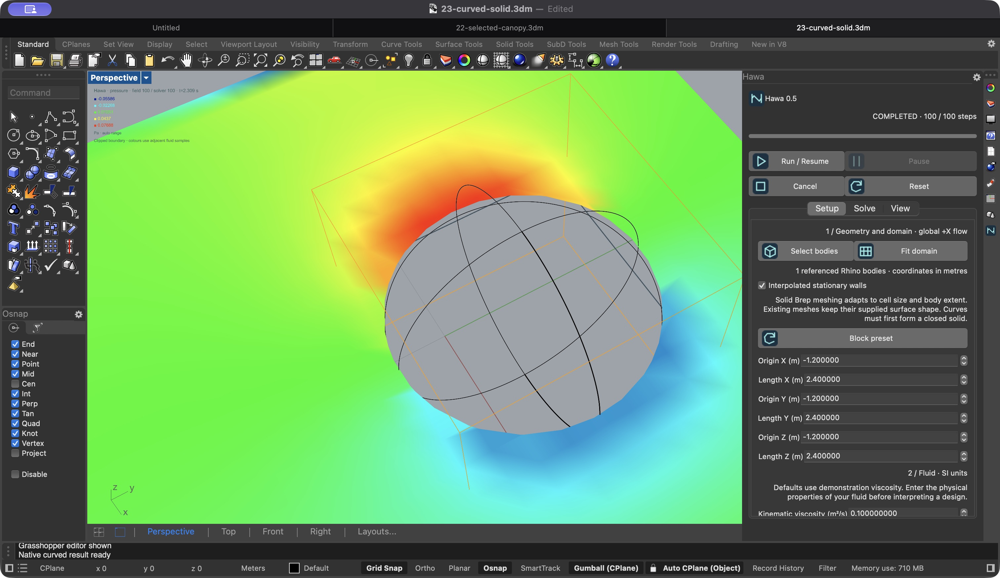

# Hawa 0.5 full local gate review

Follow-up: the older-GH cleanup finding below is resolved in the [cleanup review](review-cleanup-v0.5.md). Other limitations remain.

Run `full-gates-20261108-01`, started November 9, 2026 UTC (November 8 local).
Tested production commit `ed7a2cf633db2b3049e62c7e99d4deb7322e1a33`.
Reviewer: Codex, separate self-review passes. No independent specialist approval.

**All 22 supported example workflows ran. This is not an unrestricted release
pass.** The architecture review retains a cleanup weakness in older GH components;
PorousMedium still fails CPU/MPS parity. Windows, CUDA and clean-install checks
need their own environments. No solver or plugin assembly changed in this pass.

The [machine-readable record](verification-full-v0.5.json) contains exact host
results, numerical measurements and tested binary hashes. Raw logs, canvas
captures, recordings, copied native files and package inspection are under
`results/v05/full-gates-20261108-01` in the checkout. That large local evidence
folder is not bundled in the release ZIP.

## Gate decisions

| Gate | Decision | Evidence / disposition |
| --- | --- | --- |
| G0 research | PASS, existing scope | Existing experimental claims and method boundaries reviewed. Rhino/Eto, Kangaroo and Karamba primary guidance rechecked. KaroroCAM page unavailable on this pass; retain historical evidence only. No new dependencies or imported source. |
| G1 architecture | FAIL, whole-product cleanup invariant | Native state/lease/lifecycle checks pass. Older GH-only components catch close exceptions and discard handles without retaining retry ownership. Normal-transport teardown passed; bridge-failure recovery for these owners is not established. |
| G2 software | PASS, declared tested scope | 148 Hawa tests; 30 production state-contract checks; live invalid-input, cancellation, replacement, persistence and callback checks. Does not waive G1. |
| G3 numerical | FAIL, broad device parity | Engine oracle comparisons pass on CPU float32/float64 and MPS. Backported entrypoints run 16/16 on each device, but only 15/16 agree within existing tolerances. |
| G4 UI and examples | PASS, declared workflow scope | All supported workflows exercised; all 21 GH layouts captured/reviewed; actual tab, icons, panel, wireframe, legend and clipped pressure preview inspected. No video changes. |
| G5 release | BLOCKED, unrestricted release | Local package checks recorded separately; G1/G3 findings and unavailable Windows/CUDA/clean-install environments prevent an unrestricted release claim. No publication. |

## Executed coverage

Environment: macOS arm64, Rhino 8.36.26296.17002, embedded Python 3.9.10,
PyTorch 2.8.0, CPU and MPS. The independent reference uses Python 3.12 and its own
upstream installation. Production imports remain separate from that oracle.

| Inventory | Configuration and observed result |
| --- | --- |
| Hawa unit tests | 148 passed, 29 CUDA-dependent skips, four existing MRT warnings. |
| Upstream tests, each interpreter | 419 passed, 884 skipped, 40 warnings. Of the skips, 816 require unavailable CUDA; 68 are original unsupported/TODO/precision cases. Original test sources are unchanged. |
| Engine oracle | 96 field/checkpoint comparisons per CPU float32, CPU float64 and MPS configuration passed. Existing upstream cavity error tracked separately. |
| Original upstream entrypoints | All 16 attempted: 11 run, five fail in the original reference (cavity, mixing layer, partially saturated obstacle, Couette, Poiseuille). Those five run in the backport. |
| Backported upstream entrypoints | All 16 run on CPU and all 16 on MPS. Bounded 50 steps per simulation, except the intentional failure-detector scenario at 250. These are not full-duration convergence studies. |
| GH 01–08, 11, 14 | Ten flow graphs, 25 steps each, valid field meshes. Example 14 checks its solid-Brep connection and fractional wall links. |
| GH 12 | Offline polar input and closed wing geometry; synthetic polar data is not aerodynamic validation. |
| GH 13, 15, 16 | Saved recording/refinement targets; final recording frame and view geometry verified. Wake example 16 completes all 8,000 steps. |
| GH 17–19 | Each runs 80 steps, with valid closed moved bodies, nonempty field meshes and loads. This smoke run does not establish settled forces. |
| GH 10 | Five completed candidate IDs; pause, acknowledged pause, resume, cancel, restart, changed input, close cleanup. Hull geometry remains an ordinary GH assembly. |
| GH 20 | Two candidates with 5 Hz motion, zero settling and one measured 0.2 s cycle, reduced amplitude 0.005–0.02 m. Control and cycle protocol check, not a converged optimum. |
| Native 21 | 13 state-hardening phases, three duplicate/replacement callback phases, 17 native lifecycle phases including real Rhino UI Undo/Redo. CPU and MPS; unit conversion, stale-field withholding, reset and disposal. |
| Native 22 | Saved canopy + unbound GH template; bidirectional physical edits, 200-step MPS field, slice change without restarting, bound-definition save/reopen/wrong-case rejection. Separate mesh/Brep CPU/MPS geometry lifecycle checks pass. |
| Native 23 | Opens idle, runs 100 steps on auto-selected MPS; six speed/pressure × axis display checks. Native curved-wall geometry lifecycle also passes. |
| Cross-document identity | Two documents with the same saved case GUID remain isolated when one is edited. |
| Teardown | Zero jobs, zero sessions, no Hawa worker threads and zero pending native cleanup requests after all owned work closes. Rhino was not restarted or killed. |

Example 09 is the user's legacy Galapagos definition and is excluded. All source
`.gh` and `.3dm` hashes match their values at the start of this run, including 09.
The supported inventory is 21 GH definitions plus native-only example 23.

## Numerical interpretation

Existing tolerances were retained. Offset-sphere wall placement passes the
0.03-cell bound at cell sizes 0.2, 0.1 and 0.05 m. Sampled radial surface error
falls with refinement; maximum link error is not monotonic. Forty-step CPU/MPS
sphere populations differ by at most 1.1921e-7. Slice reconstruction preserves raw
samples and the solver session; boundary radial errors in the six slice checks
are at most 6.93e-5 m.

Fractional-wall channel relative L2 errors decrease from approximately 3.7–3.9%
to 0.61–0.72% across the existing three-grid study. Refinement benchmark errors
fall with grid size, and its measured composite-mass drift stays below 1.32e-6.
Co-moving sphere population/force invariance passes on CPU and MPS. Rotating
sphere torque error against an unbounded analytic solution decreases from 13.6%
to 6.57% to 2.99%; the simulation is a finite periodic box, so this remains a
limited reference comparison, not experimental validation.

PorousMedium's pointwise comparison fails for populations, velocity and pressure;
maximum absolute differences are 0.0007714, 0.02718 and 0.2427 respectively in the
reported field units. Density passes. Do not infer that another geometry or
integral observable has that same error. Do not widen tolerances to remove this
failure.

The canopy fixture 22 intentionally keeps voxel walls. Its preview remains
stepped. Example 23 enables interpolated stationary walls and demonstrates the
clipped lattice slice. Arbitrary Plane Field/isosurface displays and Grid Preview
retain their documented mask/grid behavior. Smooth display alone does not
establish adequate flow resolution.

## Repairs and findings

- **Repaired verification inventory:** parity previously could pass with an empty
  or incomplete report directory. Runner and comparator now share the executable
  inventory, reject empty selections, and require both device inventories.
  Regression tests cover empty, partial, extra and complete reports.
- **Repaired repeatability:** native test guards now enumerate live objects;
  Rhino object-table counts include deleted entries and previously rejected an
  otherwise empty document on a repeat run. Both native paths ran successfully.
- **Repaired template isolation:** native canopy harness opens a unique evidence
  copy. Hash checking detected host-touched source 3dm files during the earlier
  direct-open runs. Exact original bytes were restored after saving test copies;
  the copied-file rerun passed. Never use distributable native files as writable
  verification workspaces.
- **Document setup:** an early native harness ran with a different active Rhino
  document from its MCP slot. Its failure is retained in the evidence directory.
  Activating the intended Rhino command window and rerunning passed. A slot target
  alone does not choose the first binding document for an unbound Linked Case.
- **Open reliability finding:** `SolveComponents.CloseSession`,
  `OptimizationComponents.Close`, and `InputsMissing` in Runtime, Animation,
  Refinement and Motion components swallow bridge-close failures and clear their
  handles. This code review identifies a failure path; normal cleanup tests do
  not exercise transport failure. Hawa maintainer owns the follow-up: migrate
  these owners to retained idempotent cleanup, inject a close failure, dispose
  the GH document, restore transport and assert worker/session/job counts reach
  zero. This blocks the whole-product cleanup guarantee.
- **Remaining bounds:** native Brep meshing cannot be interrupted internally, and
  its face-count limit is checked after allocation. First runtime initialization
  is synchronous. These remain documented responsiveness/resource limits.

Updated the coverage count, schema description and recurring-gotcha checklist.
No example geometry, graph wiring, numerical equation or production DLL changed.

## Visual evidence and limits

All 21 GH canvases were rendered at working scale for layout inspection. These
archive renders can contain saved status text, empty panels or a cached error;
use the live workflow reports above as execution evidence. Wide examples require
panning at working zoom. A fit-to-window thumbnail is not a readable tutorial.

The remaining platform checks belong to the release maintainer: run the same
lifecycle/example matrix on Windows, run numerical comparisons on CUDA hardware,
and verify dependency installation in a clean Rhino profile. No available local
check can substitute for those environments.
