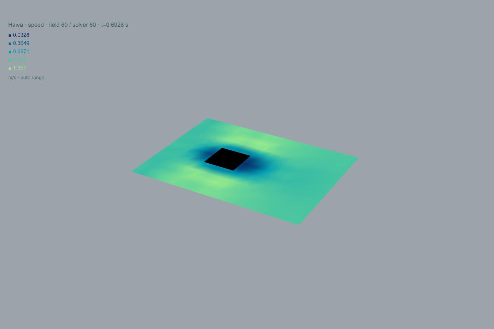

# 34 — Save a run, view it later, resume explicitly

Open [34-save-import-resume.3dm](34-save-import-resume.3dm) in Rhino 8 with
Hawa installed, then run the `Hawa` command. The document opens **idle**.
No Grasshopper definition is needed. Save your working copy under a new name.

This small CPU block-flow example demonstrates data handling. It uses a
17 × 13 × 9 grid, 0.5 m cells, 1 m/s inlet, density 1.225 kg/m³ and synthetic
viscosity 0.1 m²/s. Its 60 steps are not convergence or aerodynamic validation.

## Start with the saved result

1. In **Data**, browse to the bundled [34-block-at-60.npz](34-block-at-60.npz),
   choose import backend **cpu**, then click **Import data**.
2. Wait for **imported** and **paused**. The field and solver should both show
   **60**, at **0.692820323 s**. Importing never starts another step.
3. In **View**, change the slice position, plane, field or palette. Accepted edits
   apply directly. There is no Update/Apply step. The solver stays at 60.
   Turn **Domain wireframe** off for an unobstructed view; this also hides the
   boundary labels. Imported physical settings are read-only.

The hole is the represented solid region; interpolated display colours do not
add solver resolution. The legend records the actual field capture and units.

## Export numbers

1. In **Export**, choose **fields**, browse to a new `fields-60.csv`, then
   **Export CSV**. Wait for completion. Expect **1,989 rows** and capture step 60.
2. To sample probes, create Rhino **Point** objects at `(1,1,1)` and `(1,2,1)`
   in this metre document. Select them, click **Capture selected probes**, choose
   **probes**, choose a new `probes-60.csv`, then **Export CSV**.
3. The two fluid points should be valid. As a deliberate invalid case, also
   capture `(-1,1,1)`: its row has `valid=0` and empty numerical values.
   Selection enumeration determines row order; use each row's coordinates and
   probe index. Re-capture after changing point locations or document units.

CSV begins with a metadata comment, then a header and data. Read its units,
validity and capture identity before plotting. Solid/boundary field rows are
retained with empty invalid quantities, not invented zeros. CSV is numerical
interchange; **Import data** accepts the native NPZ checkpoint, not CSV.

## Resume and save your own checkpoint

1. Set **Total target iterations** to **120**. This alone does not resume.
2. Click **Run / Resume** and wait for completed step 120
   (**1.385640646 s**). Wait separately for the displayed field to reach 120.
3. In **Data**, choose a new `my-block-at-120.npz`, then **Save data**. Wait
   for **saved**. Keep the bundled 60-step file unchanged for repeatable trials.
4. Import your new file: it opens paused at 120. You can inspect/export again,
   or set a larger total target and explicitly resume.

To create the 60-step checkpoint yourself, reopen the original idle `.3dm`,
click Run, wait for completed step 60, and Save data to a new NPZ path.
Changing Setup changes the physical case; View edits preserve it. A failed
import preserves the accepted case. Saving an imported `.3dm` stores identity,
not populations: reopen it and import the NPZ again before resuming.

## Verification and maintenance

Mac Rhino CPU: the shipped file was generated by the public CaseHub operations,
imported paused, viewed without advancing, exported as fields/probes, and resumed
to 120. The idle `.3dm` was reopened and stayed idle. An independent CPU run
matched the shipped populations and continued populations exactly on that Mac.
Windows UI, other-device bitwise identity and physical accuracy are not claimed.

Maintainer: Hawa contributors. Reproduce with
`scripts/create_native_data_example.cs` through Rhino MCP after adjusting its
checkout root; it writes new artifacts under a unique results directory and
never overwrites shipped examples. Run the artifact test
`tests/test_native_data_example.py` and follow the
[review record](../../docs/review-workflow-examples.md). Existing user documents
and legacy example 09 must remain untouched.

[Data format and limits](../../docs/native-data.md) ·
[CSV contract](../../docs/numerical-export.md)
